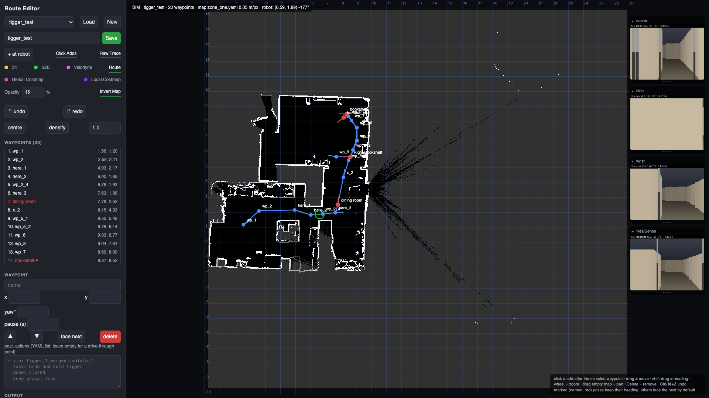
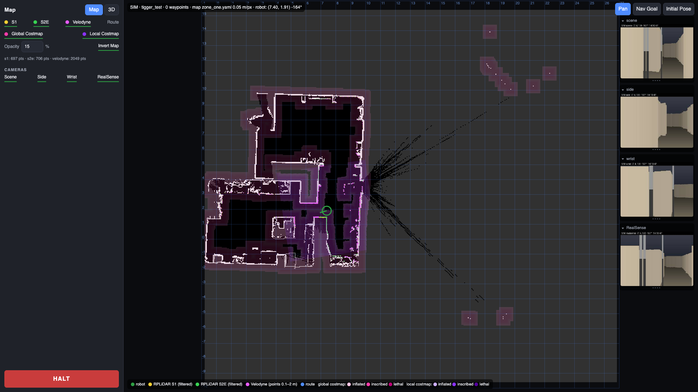
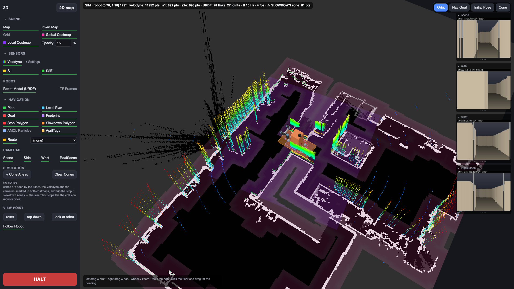

# Robot Disco - ROS2 Workspace


*The diagram dates from 2026-04 and has not kept up: the T265, the Bluetooth speaker and the TCP hand relay are gone; the Jetson Orin robot PC, the route editor pages, the voice assistant, the VLA submodule and the GPU box are missing from it.*

A ROS 2 Humble workspace for Robot Disco: a differential-drive mobile robot (RoboClaw base, RPLiDAR S1 + S2E and a Velodyne for navigation, a RealSense D435 for AprilTag relocalization) carrying a UR5e arm with the 8-DOF AmazingHand, an animated face on a portrait display, a microphone and a USB speaker. The robot PC has been an NVIDIA Jetson AGX Orin (Ubuntu 22.04, 512 GB NVMe at `/mnt/data`) since 2026-10-10; it also runs the VLA policy inference server. A separate GPU box (RTX 4090, `192.168.11.119`) trains policies and hosts the web manager. What lives here:

- **Navigation**: `robot_disco` (bringup, AMCL / slam_toolbox, Nav2, the collision monitor, AprilTag relocalization) and the browser pages in `Scripts/` (route editor, 2D map, 3D view, landmarks, cameras, HALT), plus `path.py`, the route runner that drives waypoints and runs arm policies at them.
- **The face**: `robot_face`, GPU-rendered eyes and a speech-driven mouth, on-robot face recognition that learns who it meets, Kokoro speech, a UR5e wave with a finger wiggle, and the Folks web page.
- **The voice**: `robot_voice`, the "Robot Disco, …" wake phrase, Whisper ears, Claude or a local Ollama model as the brain, and skills (weather, news, Home Assistant, music, volume, navigation, landmark tasks).
- **VLA**: the `VLA/` git submodule (LeRobot teleop and recording, SmolVLA training on the GPU box, the inference server on the robot, the camera service, the web manager). Its own docs are `VLA/README.md` and `VLA/wiki/`.
- **Provisioning and deployment**: `provision/` rebuilds a robot PC or the GPU box from scratch; `provision/deploy_to_rd.sh` is how code reaches the robot (it is not git-synced).

---

## Table of Contents

- [Workspace Structure](#workspace-structure)
- [Packages](#packages)
  - [robot_face](#robot_face)
  - [robot_voice](#robot_voice)
  - [AmazingHand](#amazinghand)
  - [robot_disco](#robot_disco)
  - [apriltag / apriltag_ros](#apriltag--apriltag_ros)
  - [roboclaw](#roboclaw-motor-controller)
  - [velodyne / rplidar_ros](#velodyne--rplidar_ros)
  - [VLA (submodule)](#vla-submodule)
- [Hardware Peripherals](#hardware-peripherals)
  - [WLED LED Matrix Panels](#wled-led-matrix-panels)
  - [Audio: USB speaker and microphone](#audio-usb-speaker-and-microphone)
  - [RealSense T265 Tracking Camera (retired)](#realsense-t265-tracking-camera-retired)
- [Foxglove Studio](#foxglove-studio)
- [Supervisor Services](#supervisor-services)
- [Provisioning a New Robot PC](#provisioning-a-new-robot-pc)
- [Deploying to the robot (`provision/deploy_to_rd.sh`)](#deploying-to-the-robot-provisiondeploy_to_rdsh)
- [Quick Start](#quick-start)
  - [Build](#build)
  - [Run robot_face](#run-robot_face)
  - [Control eye mood at runtime](#control-eye-mood-at-runtime)
  - [Teach the robot who you are](#teach-the-robot-who-you-are)
  - [Drive the mouth from your own audio](#drive-the-mouth-from-your-own-audio)
- [Hardware Bringup](#hardware-bringup)
  - [UR5e Arm](#ur5e-arm)
  - [Static Transforms](#static-transforms)
  - [RealSense Camera](#realsense-camera)
  - [Navigation Stack](#navigation-stack)
  - [Maps](#maps)
- [Utilities](#utilities)
  - [AprilTag detection with RealSense](#apriltag-detection-with-realsense)
  - [Route editor, 2D map and 3D view in the browser (`Scripts/route_editor.py`)](#route-editor-2d-map-and-3d-view-in-the-browser-scriptsroute_editorpy)
  - [Recording a route by driving (`Scripts/record_path.py`)](#recording-a-route-by-driving-scriptsrecord_pathpy)
  - [Waypoint runner (`Scripts/path.py`)](#waypoint-runner-scriptspathpy)
  - [Publish a battery state for testing](#publish-a-battery-state-for-testing)

---

## Workspace Structure

```
rd_ws/
├── src/
│   ├── robot_face/             # Animated face (eyes + mouth), face recognition, Kokoro speech, UR wave, Folks page (active)
│   ├── robot_voice/            # "Robot Disco, …" voice assistant: Whisper ears, Claude / Ollama brain, skills, landmark tasks (active)
│   ├── robot_disco/            # Mobile base: bringup, nav2, maps, joystick, AprilTag relocalization (submodule, r1b4z01d/Robot_Disco)
│   ├── apriltag/               # AprilTag C library (submodule)
│   ├── apriltag_ros/           # ROS2 AprilTag wrapper (submodule; patched on the Jetson, see provision/patches/)
│   ├── AprilTag_Detection/     # AprilTag demo package (submodule; its upstream is gone, left empty on new boxes)
│   ├── foxglove_bridge/        # Foxglove WebSocket bridge (submodule)
│   ├── pyDHgripper/            # DH gripper library (submodule, unused on the robot)
│   ├── roboclaw_hardware_interface/  # RoboClaw ros2_control HW interface (submodule)
│   ├── roboclaw_serial/        # RoboClaw serial library (submodule)
│   ├── roboclaw_ros/           # RoboClaw ROS2 node (submodule)
│   ├── norlab_custom_interfaces/    # Custom ROS message types (submodule)
│   ├── velodyne/               # Velodyne 3D LiDAR driver (submodule)
│   └── rplidar_ros/            # RPLiDAR 2D driver (submodule)
├── VLA/                        # LeRobot teleop/recording, SmolVLA training + inference, camera service, web manager (submodule, r1b4z01d/VLA)
├── AmazingHand-main/           # The 8-DOF hand: CAD, ESP32 firmware (UDP/TCP line protocol), demos (submodule, r1b4z01d/AmazingHand)
├── Scripts/                    # Browser pages + tools (no ROS package):
│   ├── route_editor.py / .html #   route editor, 2D map (?view=map), landmarks + tasks API, cameras, HALT (unit robot_disco_route_editor, :8092)
│   ├── map3d.html, static/     #   the 3D view (/3d; three.js + urdf-loader vendored, cams.js, swatches.js)
│   ├── sim_robot.py, sim/      #   `route_editor.py --sim`: a simulated robot + sensors from the map alone (URDF, meshes via fetch_assets.sh)
│   ├── path.py                 #   waypoint runner: Nav2 FollowWaypoints + post_actions (shell, pause, vla: policy runs)
│   ├── record_path.py          #   record a route by driving; simplify / center / densify
│   ├── dev_stack.sh            #   the whole GUI on a laptop: sim editor + MuJoCo teleop panel + manager
│   ├── landmarks/              #   landmarks.yaml + img/ (created by the editor; photos are git-ignored)
│   ├── *.yaml, *.svg           #   routes (waypoints.yaml, tigger_route.yaml, …) and their recorded traces
│   ├── install_services.sh     #   installs services/*.conf into supervisor
│   └── ur_power.py, force_mode.py, make_apriltag_pdf.py, cube.py, examples.py   # UR5e and AprilTag tools
├── services/                   # Supervisor units (robot_disco*, robot_face, robot_voice, ollama) + fastdds_no_shm.xml (UDP-only DDS)
├── provision/                  # Provisioning kit: provision.sh (phases), jetson/, gpu/, deploy_to_rd.sh, capture_rd_state.sh, patches/, pulse/, setup_*.sh
├── foxglove_studio/            # Foxglove Studio fork + the docker image/layout (manual-start since 2026-11-01)
├── rviz/                       # view_robot.rviz
└── documents/                  # Datasheets (RoboClaw, RPLiDAR, TeraRanger), the AprilTag print sheet, architecture diagram, img/ (page screenshots)
```

Initialize the ROS submodules with `git submodule update --init --recursive -- src/` (on a fresh box `provision.sh workspace` does this one at a time, so a dead upstream does not abort the rest). `VLA/` and `AmazingHand-main/` are top-level submodules: `git submodule update --init VLA` on a machine with internet; the robot has none and gets the VLA tree by rsync (see [Deploying to the robot](#deploying-to-the-robot-provisiondeploy_to_rdsh)).

---

## Packages

---

### robot_face

**Path**: `src/robot_face/`
**Maintainer**: Bryan Ribas (bryanribas@gmail.com)
**License**: CC BY-NC-SA

Provides a real-time animated robot face driven by the camera. The face is drawn in a GPU-accelerated OpenGL window: two eyes with moods, blinking and gaze tracking, and a mouth that rests in a slight smile, traces the robot's speech as a waveform, and pulls random expressions while nobody is around. The node recognises people it has met (ArcFace embeddings from a worker process in its own venv, OpenCV YuNet + SFace as the fallback; learned on the fly and persisted to disk), greets them by name through Kokoro TTS, waves the UR5e arm at people it knows while the AmazingHand's fingers ripple, serves the **Folks** web page of the people it knows, and keeps the USB speaker the default audio sink. An optional legacy mode streams the operator's hand joints to the AmazingHand over TCP (`relay_hand`); the robot runs with `face_only: true`, which never loads the hand model.

#### Architecture

```
Camera Image Topic
       │
       ▼
 combined_face_hand_node
 ├── Tracker                    → SCRFD face detector (tracker: face, the default with ArcFace) or MediaPipe Pose
 │                                → person box → gaze target, "someone is here"
 ├── FaceIdentifier (face_id)   → faceid_worker.py (InsightFace venv: SCRFD + ArcFace) or YuNet + SFace → people gallery (JSON)
 ├── Greeting / TTS             → "hello" / "hello <name>" / wink on a repeat visit → kokoro_worker.py (Kokoro-82M venv) → Coqui → espeak
 │                                → WAV → aplay (pinned to the USB sink) → mouth waveform; ~/say speaks anything
 ├── UR wave (ur_motion, ur_dashboard) → replays the recorded wave over ur_rtde, powers the arm up first if needed
 ├── HandWiggle (hand_wiggle)   → UDP J: lines to the hand's ESP32 while the arm waves
 ├── Mouth state                → smile (wider when seeing someone), speech level, idle gestures
 ├── MediaPipe Hands detector   → finger curl angles → TCP hand relay (legacy; off with face_only)
 ├── GlEyeRenderer (OpenGL)     → eyes + mouth window (GPU)
 ├── SinkWatchdog (audio_sink)  → keeps the C-Media USB adapter the default PulseAudio sink
 ├── Folks page (people_web)    → http://<robot>:8096/, the people the robot knows
 └── ROS interfaces             → mood / wave / wink services, mouth and say topics, people naming / listing
```

#### Source Files

| File | Purpose |
|---|---|
| `combined_face_hand_node.py` | Main ROS2 node — orchestrates all subsystems |
| `gl_eye_renderer.py` | GPU-accelerated eye renderer (OpenGL 3.3 + GLSL) |
| `eye_renderer.py` | CPU-based eye renderer (OpenCV fallback) |
| `audio_utils.py` | WAV loading, chunking and loudness helpers for the mouth waveform |
| `audio_sink.py` | `SinkWatchdog`: keeps the USB speaker the default PulseAudio sink, pins `aplay` to it |
| `tts_engines.py` | Speech back-ends: Kokoro (worker process), Coqui, espeak; the `~/say` path |
| `kokoro_worker.py` | Long-lived Kokoro-82M synthesiser, run in `~/.robot_face/kokoro-venv` (JSON over a pipe) |
| `face_id.py` | Face identification front end: galleries, matching, enrolment, both back-ends |
| `faceid_worker.py` | SCRFD + ArcFace worker, run in `~/.robot_face/faceid-venv` (InsightFace, onnxruntime-gpu on the Orin) |
| `people_web.py` | The Folks page: people, pictures, names, greetings (stdlib HTTP on :8096) |
| `ur_motion.py` | Replays a recorded joint trajectory on the UR5e over ur_rtde (the wave), staged approach/return, home pose |
| `ur_dashboard.py` | UR Dashboard Server client: power up, brake release, protective-stop / fault recovery, program play |
| `hand_wiggle.py` | Finger ripple over UDP to the AmazingHand ESP32 during the wave |
| `mouth_gestures.py` | Idle mouth gesture library: timings, shapes and morph envelopes (no ROS dependency) |
| `face_utils.py` | Pose landmark → bounding box, face tracking/hysteresis |
| `hand_processing.py` | Hand landmarks → servo joint angles → TCP command string (legacy relay) |
| `window_utils.py` | Cross-platform global hotkey detection (Win/Linux/macOS) |
| `models/` | YuNet + SFace ONNX models for the OpenCV face-ID fallback (installed to `share/robot_face/models`) |
| `motions/wave.json` | The arm's wave, installed to `~/.robot_face/motions/` by provisioning |
| `scripts/ur_record_motion.py` | Record the wave (freedrive demonstration, keyframes, or the pendant program) and capture the home pose |
| `scripts/ur_path_eval.py` | Forward-kinematics check of the staged approach/return orders for the wave |
| `test_eye_renderer.py` | Standalone visual test of the renderer, no ROS required |

#### Node: `combined_face_hand_node`

**Entry point**: `robot_face.combined_face_hand_node:main`

**Subscriptions**:

| Topic | Type | QoS | Description |
|---|---|---|---|
| `/camera/camera/color/image_raw` (configurable) | `sensor_msgs/Image` | BEST_EFFORT, depth=1 | Live camera frames for detection |
| `~/mouth_level` (configurable) | `std_msgs/Float32` | BEST_EFFORT, depth=1 | Speech loudness 0..1; drives the mouth waveform amplitude |
| `~/mouth_audio` (configurable) | `std_msgs/Float32MultiArray` | BEST_EFFORT, depth=1 | Raw audio chunk, samples in -1..1; drawn as the mouth waveform |
| `~/set_person_name` | `std_msgs/String` | default | Name the person in view (`"Bryan"`), or by id (`"person_3=Bryan"`) |
| `~/forget_person` | `std_msgs/String` | default | Forget a person by id or name, or `"all"` |
| `~/say` | `std_msgs/String` | default | Speak the text with the current TTS engine (the voice assistant's replies arrive here) |

**Publications**:

| Topic | Type | Description |
|---|---|---|
| `~/person` | `std_msgs/String` | JSON `{id, name, score, new, box}` each time face ID runs on the tracked person |
| `~/speaking` | `std_msgs/Bool` | True while the robot's own voice is playing (the voice assistant mutes its microphone) |

**Services Provided**:

| Service | Type | Description |
|---|---|---|
| `~/set_mood/neutral` | `std_srvs/Trigger` | Neutral eye expression |
| `~/set_mood/tired` | `std_srvs/Trigger` | Drooping tired eyes |
| `~/set_mood/angry` | `std_srvs/Trigger` | Angled angry brows |
| `~/set_mood/happy` | `std_srvs/Trigger` | Squinting happy eyes |
| `~/set_mood/suspicious` | `std_srvs/Trigger` | One-eyebrow-up suspicious look |
| `~/list_people` | `std_srvs/Trigger` | List learned people (id, name, views, times seen) |
| `~/wave` | `std_srvs/Trigger` | Play the UR wave program now (ignores the cooldown; still refuses while the arm is busy) |
| `~/wink` | `std_srvs/Trigger` | Wink one eye now (`wink_eye`) |

**ROS Parameters**. Defaults below are those of `config/combined_face_hand_defaults.yaml`, which the launch file and the supervisor unit load; where the node's own default (used by a bare `ros2 run`) differs it is noted.

*Vision & Display*

| Parameter | Default | Description |
|---|---|---|
| `image_topic` | `/camera/camera/color/image_raw` | Camera topic. `sensor_msgs/Image`, or `sensor_msgs/CompressedImage` when the name ends in `compressed` (e.g. the VLA camera bridge's `/vla/cameras/scene/image/compressed`) |
| `render_fps` | `30.0` | The face animates on its own timer at this rate; camera frames only steer it, so a stopped camera never freezes the face |
| `camera_timeout` | `3.0` | Seconds without frames before the face drops the tracked person and logs a warning |
| `fullscreen` | `true` | Start fullscreen on the primary monitor. Clicking the face, or pressing F, toggles windowed/fullscreen; Esc leaves fullscreen. Live-settable with `ros2 param set` |
| `width` | `1280` | Camera frame width (px) |
| `height` | `720` | Camera frame height (px) |
| `fps` | `30.0` | Expected capture framerate |
| `mirror` | `true` | Mirror the camera image (selfie-style gaze); node default `false` |

*Eye Rendering*

| Parameter | Default | Description |
|---|---|---|
| `face_only` | `true` | Eyes, mouth, face ID and speech only: the MediaPipe hand model is never loaded and the hand panel / TCP relay are off (saves a lot of CPU); node default `false` |
| `hand_in_eyes` | `false` | Draw hand skeleton inside eye window |
| `hand_panel_height` | `1000` | Hand panel pixel height (node default 400) |
| `hand_panel_fraction` | `0.8` | Fraction of screen height for hand panel (node default 0.5) |
| `hand_panel_scale` | `1.0` | Scale factor for hand panel |

*Blink Behavior*

| Parameter | Default | Description |
|---|---|---|
| `blink_min` | `2.5` | Minimum seconds between blinks |
| `blink_max` | `15.5` | Maximum seconds between blinks |
| `blink_duration` | `0.14` | Total blink cycle duration (s); node default 0.18 |
| `blink_closed_hold` | `0.05` | Time held fully closed during blink (s); node default 0.04 |

*Gaze & Tracking*

| Parameter | Default | Description |
|---|---|---|
| `gaze_speed` | `0.3` | Gaze smoothing when face is detected (0.01–1.0) |
| `gaze_idle_speed` | `0.01` | Gaze smoothing when no face (idle scan) |

*Mouth Waveform*

| Parameter | Default | Description |
|---|---|---|
| `mouth_enabled` | `true` | Draw the mouth waveform below the eyes |
| `mouth_level_topic` | `~/mouth_level` | `std_msgs/Float32` loudness input (0..1) |
| `mouth_audio_topic` | `~/mouth_audio` | `std_msgs/Float32MultiArray` raw sample input (-1..1) |
| `mouth_gap` | `550.0` | Eye bottom edge → waveform centre line (px) |
| `mouth_amplitude` | `70.0` | Peak displacement at full loudness (px) |
| `mouth_width` | `0.0` | Waveform width in px (0 = span between eye centres) |
| `mouth_gain` | `1.0` | Multiplier applied to incoming level / samples |
| `mouth_attack` | `0.6` | Per-frame smoothing when getting louder (0.01–1.0) |
| `mouth_release` | `0.12` | Per-frame smoothing when getting quieter (0.01–1.0) |
| `mouth_timeout` | `0.4` | Seconds without input before the mouth returns to idle |
| `mouth_smile` | `25.0` | Resting upward curl of the mouth ends (px); negative frowns |
| `mouth_smile_happy` | `70.0` | Curl while a person is in view (px) |
| `mouth_gestures` | `true` | Random idle gestures (see list below) when nobody is around |
| `mouth_gesture_min_interval` | `4.0` | Minimum seconds between idle gestures |
| `mouth_gesture_max_interval` | `12.0` | Maximum seconds between idle gestures |

The mouth is a glowing line centred under the eyes whose ends curl up into a slight smile at rest, and a wider one while someone is in view. With no audio it holds perfectly still; when nobody is around it occasionally performs a short random gesture, which stops as soon as a person appears. Gestures live in `mouth_gestures.py`; shape gestures morph the resting line into a polyline and back:

| Gesture | Look |
|---|---|
| `hum`, `wiggle` | brief waveform motion |
| `grin`, `pout`, `smirk` | ends curl up / down, or tilt to one side |
| `skeptical` | straight line slanted down to one side |
| `shocked` | small "O" |
| `puckered` | sideways "3" / "w" |
| `anxious` | sharp zig-zag with a nervous shake |
| `slack_jawed` | deep drooping "U" |
| `playful` | flat line with a small tongue loop that wags |
| `grimace` | upside-down "V" |
| `shouting` | large "V" |
| `quivering` | gentle curve with shaky stutters |
| `puzzled` | asymmetric check mark |

Preview them all in the standalone test with the `G` key. Publish a loudness level and it becomes a procedural travelling waveform whose amplitude, stroke width and glow scale with the level; publish raw audio chunks and the line traces the samples themselves (resampled to 512 points). The level is smoothed with a fast attack and slow release so syllables read clearly, and it decays to idle after `mouth_timeout` seconds of silence. The waveform is redrawn on the face's own `render_fps` timer, so it keeps moving even when the camera stalls.

```bash
# Quick check: make the mouth "talk" at 80% loudness
ros2 topic pub -r 20 /combined_face_hand/mouth_level std_msgs/msg/Float32 "{data: 0.8}"
```

*Greeting (TTS)*

| Parameter | Default | Description |
|---|---|---|
| `greeting_enabled` | `true` | Say hello and look happy when a new person is detected |
| `greeting_text` | `hello` | Phrase spoken for strangers and unnamed people |
| `greeting_known_text` | `hello {name}` | Phrase spoken for people you have named |
| `greeting_late_text` | `oh, hi {name}` | Follow-up when the name is recognised after the generic greeting |
| `greeting_wait` | `2.0` | Seconds to wait for face ID before falling back to the generic greeting |
| `greeting_name_window` | `10.0` | Seconds after a generic greeting during which a recognised name is still spoken |
| `greeting_happy_seconds` | `30.0` | How long the happy mood lasts after a greeting |
| `greeting_cooldown` | `3600.0` | A recognised person (named or not) is greeted at most once per this many seconds; the time of the last hello is stored with the person, so it survives restarts. `0` greets on every visit. The Folks page shows "last hello" per person and a **Reset hello** button that clears it |
| `wink_eye` | `right` | Someone who comes back inside the cooldown gets a wink instead of a hello: this eye (screen `left` / `right`) closes. `ros2 service call /combined_face_hand/wink std_srvs/srv/Trigger` winks on demand |
| `wink_duration` | `0.7` | The whole wink: close, hold, open (s) |
| `wink_depth` | `0.9` | How far the eye closes: `1.0` shuts it, `0.9` leaves a sliver open |
| `audio_sink` | `C-Media` | Speaker: PulseAudio sink name or fragment. A watchdog keeps it the default sink whenever it is present (the dock adapter enumerates after pulse at boot, so `default.pa`'s `set-default-sink` misses it and the voice lands on the onboard jack) and `aplay` is pinned to it with `PULSE_SINK`; `""` leaves the default alone |
| `audio_sink_check` | `5.0` | Seconds between default-sink checks |
| `speech_lead_silence` | `1.5` | Seconds of lead-in prepended to every utterance so the USB speaker is awake before the first word |
| `speech_lead_level` | `0.01` | The lead-in is a faint 50 Hz tone at this level (about -40 dBFS) because many speakers only wake on a real signal; `0` makes it pure silence |

*UR arm gesture (wave)*

When a person is recognised by name the node also plays a program saved on the UR teach pendant, through the
arm's Dashboard Server (TCP 29999): `load wave.urp`, `play`, then it polls `programState` until the program ends
(stopped at 40 s). It only ever starts programs the pendant already has. Before each play it checks that PolyScope is in
Remote Control, the robot mode is RUNNING (powered, brakes released), the safety status is NORMAL and nothing is running;
while the VLA teleop or eval drive the arm through ur_rtde the wave is skipped with a log line ("arm is busy"). Test it
with `ros2 service call /combined_face_hand/wave std_srvs/srv/Trigger`.

| Parameter | Default | Description |
|---|---|---|
| `ur_wave_enabled` | `true` | Wave when someone is recognised |
| `ur_ip` | `192.168.11.21` | UR controller address |
| `ur_wave_program` | `wave.urp` | Program under `/programs` on the pendant |
| `ur_wave_cooldown` | `20.0` | Minimum seconds between waves |
| `ur_wave_known_only` | `true` | Only for people recognised by name; `false` waves on every hello |
| `ur_wave_source` | `auto` | `auto` plays the recording when the file exists, else the pendant program; or force `recording` / `dashboard` |
| `ur_wave_motion_file` | `~/.robot_face/motions/wave.json` | Joint trajectory written by `scripts/ur_record_motion.py` |
| `ur_wave_return` | `home` | Where the arm goes after the wave: `home` = the joints in `ur_wave_home_file`, `start` = where it was before the wave, `none` |
| `ur_wave_home_file` | `~/.robot_face/motions/home.json,~/rd_ws/VLA/outputs/home_pose.json` | Comma-separated, first existing wins: the wave's own forward home (`scripts/ur_record_motion.py --capture-home`), else the eval/training home the teleop panel's *Set Home* captured; none = fall back to `start` |
| `ur_wave_approach_order` | `""` | Joint stages for home → wave pose (digits = joints 0 base … 5 wrist 3, `>` = next stage, `""` = all at once); only needed for a recording that starts far from home, see `scripts/ur_path_eval.py` |
| `ur_wave_return_order` | `""` | Joint stages for wave pose → home |
| `ur_wave_retrace` | `true` | A take that starts at home but ends elsewhere returns along its own samples, backwards, from the earliest sample within 20 deg of the end pose: the path home is one you demonstrated, never a straight joint ramp |
| `ur_wave_retrace_speedup` | `1.5` | Playback speed of that retrace (1 = as demonstrated) |
| `hand_wiggle_enabled` | `true` | AmazingHand: index, middle and ring wave between open and `hand_wiggle_curl` at `hand_wiggle_hz` while the arm waves, each finger `hand_wiggle_phase` of a period behind the previous one (a wave running index → ring), the thumb held at `hand_thumb_curl`; fingers open again for the way home |
| `hand_host` / `hand_port` / `hand_speed` | `192.168.11.117` / `8766` / `500` | The hand's ESP32 (UDP `J:` lines, the VLA teleop's protocol) and the firmware speed (50..2000). A hand that does not answer the `Q` probe is logged and skipped |
| `hand_wiggle_hz` | `0.5` | Finger ripples per second |
| `hand_wiggle_curl` | `0.333` | How far the fingers close (0 open .. 1 closed): between fully open and 2/3 open |
| `hand_thumb_curl` | `0.0` | The thumb's fixed curl during the wave |
| `hand_wiggle_phase` | `0.25` | Fraction of a period between neighbouring fingers (index leads, middle and ring trail) |
| `ur_wave_power_up` | `true` | Arm IDLE, powered off or in a protective stop: run the same startup as eval/training first (`power on`, `brake release`, protective-stop unlock, safety restart after a fault) |

PolyScope sometimes refuses the dashboard `play` with a bare "Failed to execute" and no reason (seen on 5.21 with
everything green). So the wave is normally a **recording** driven the same way the teleop drives the arm. The easiest
recording is a **freedrive demonstration**: `python3 src/robot_face/scripts/ur_record_motion.py --capture-home
--freedrive --say` on RD releases the arm (teach mode) and the face talks you through two phases: first hold the arm
still in the wave's **forward home** (saved to `~/.robot_face/motions/home.json`, separate from the eval/training home
in `~/rd_ws/VLA/outputs/home_pose.json`; skip the flag to keep the home you have), then guide it through the gesture from
that home back to it. The recording starts at your first movement and ends after 4 s of stillness (a nudge under 15 deg
or a take under 2 s is discarded and it waits again); the arm locks, the trace is smoothed (100 ms) and saved, and the
previous file is kept with a timestamp. Or build it **point by point** with `--keyframes`: where the arm is when the
script starts is point one, every pose you then hold still for 4 s is the next point (the face counts them), and holding
10 s longer at the last point finishes; the motion eases between the points at `--speed` (0.6 rad/s), with the home pose
added before the first and after the last point, and the points are kept in `wave_keyframes.json`. `--release` just
frees the arm so you can place it by hand (it locks again when held still). The wave in use since 2026-11-02 is two
keyframes from the front home, `--regen --repeat 2 --speed 1.0`: hand sweeps 26 cm right, 27 cm left, twice, back to
centre. The replay is **paced by the arm**: a sample is only advanced past once the arm is within 11 deg of it, so a
recording faster than the UR allows (its safety speed limits scale servoJ down) plays at the controller's own pace
instead of tripping the lag abort — at 1.0 rad/s the two swings take 12 s, and asking for more would not make it
faster. While the arm waves the AmazingHand's index, middle and ring fingers ripple between fully open and 2/3 open at
0.5 Hz with the thumb still (`hand_wiggle_*`), and open again for the way home. Alternatively record the pendant's
program: run the script without `--freedrive`, press Play on the pendant once (Local Control), and it samples the
joints over RTDE while `wave.urp` runs; a looping program ("loops forever", PolyScope's default) is cut to one cycle.
The node then replays the JSON through ur_rtde exactly like `rtde_arm.py`'s streamer: servoJ at the
recorded rate (20 ms servo time, 0.1 s lookahead, gain 300), a joint-space ramp at 0.5 rad/s from wherever the arm is to
the first sample, the samples, a ramp to the **home pose** (`ur_wave_return: home`, the same joint-space walk the eval's
HOME key does, so the arm ends every wave where the eval and the teleop panel park it), then servoStop/stopScript. A
per-tick joint step cap (0.2 rad) bounds any bad sample, a protective or emergency stop aborts the motion, and it refuses
when the arm is more than 143 deg from the start pose on any joint, unless it is parked at home (home ↔ wave pose is a
known route, 203 deg on wrist 2).

The two ramps are **staged** so the hand stays closer to the robot's width on the way out and back, and never passes
over the robot. Moving every joint at once swept the fingertips 50 cm from the centreline on the way to the wave pose
and 45 cm on the way home (the base turns 48 deg while wrist 2 swings 200 deg with the arm extended); the body is
27 cm to each side and the wave pose itself holds the hand 43 cm out. `scripts/ur_path_eval.py` runs nominal UR5e
forward kinematics (arm base on the back lidar, yawed so the robot's lateral axis is the arm frame's x) over every 1-4
stage joint ordering, drops every ordering in which any part of the arm passes above the chassis footprint (the first
picks, chosen on lateral reach alone, swung the hand over the top of the robot and were stopped there twice), and
ranks the rest by the hand's lateral peak during the transit: `2345>0>1` (elbow and wrists together, then the base,
then the shoulder dips the hand out into the wave pose) peaks at 36 cm, `015>34>2` home peaks at 35 cm, for about
2.3 s more each way than the straight ramps. The 27 cm body width is not reachable without re-recording the wave
closer to the body. Re-run the script after re-recording the wave or capturing a new home pose; it prints the orders
to put in `ur_wave_approach_order` / `ur_wave_return_order`. From any other start pose the approach moves all joints
at once as before. Every play writes a per-tick trace (commanded, actual and target joints, runtime state, speed
scaling) to `~/.robot_face/motions/last_wave_trace.csv`; a ramp that stops making progress for a second while the
command is ahead (someone holding the arm, an obstacle, a frozen RTDE stream) aborts with servoStop instead of
waiting, and a stopped control script is re-uploaded once. Because it takes the RTDE control interface, it never runs while the teleop or eval hold the arm
(the "arm is busy" check) and they reconnect the way they always do if they come up right after a wave.

After a reboot the UR sits in IDLE with the brakes on, and a protective stop leaves it stuck too. With
`ur_wave_power_up` the wave first runs the arm startup eval_hw and the teleop panel use (a port of VLA's
`ur_power.power_up`, kept in step with it): Remote Control required, `close safety popup` + `restart safety` after a
FAULT/VIOLATION, `close safety popup` + `unlock protective stop` after a protective stop, then `power on` and `brake
release`, waiting for RUNNING. Each auto-clear is logged; like the eval, it releases the brakes without knowing whether
the arm is clear, so keep the workspace clear. Set it `false` to have the wave refuse instead.

*Text-to-Speech*

| Parameter | Default | Description |
|---|---|---|
| `tts_engine` | `auto` | `auto` picks Kokoro if installed, else Coqui, else espeak; or force `kokoro` / `coqui` / `espeak` |
| `tts_voice` | `af_heart` | Kokoro voice id (`af_*`/`am_*` American female/male, `bf_*`/`bm_*` British); 54 available |
| `tts_speed` | `1.0` | Kokoro speaking rate |
| `tts_lang` | `auto` | Phonemisation language; `auto` derives it from the voice prefix (a/b English, e Spanish, f French, h Hindi, i Italian, j Japanese, p Portuguese, z Mandarin) |
| `kokoro_python` | `~/.robot_face/kokoro-venv/bin/python` | Python of the venv holding `kokoro-onnx` |
| `kokoro_model_dir` | `~/.robot_face/kokoro` | Folder with `kokoro-v1.0.onnx` and `voices-v1.0.bin` |

The preferred voice is [Kokoro-82M](https://github.com/hexgrad/kokoro) through [kokoro-onnx](https://github.com/thewh1teagle/kokoro-onnx): on RD's CPU it loads in under a second and synthesises a short phrase in about 0.4 s. `kokoro-onnx` needs numpy 2, which the ROS/MediaPipe stack cannot have, so it is installed in its own virtualenv and the node runs `kokoro_worker.py` there as a long-lived worker process, talking to it over a pipe (one JSON request per line, model loaded once). If the worker is missing or dies, the node falls back to Coqui, then espeak. Install it with `provision/setup_kokoro.sh` (online, or offline with a wheel folder plus the two model files). Anything published on `~/say` (`std_msgs/String`) is spoken with the current engine, which is the quickest way to audition voices:

```bash
ros2 topic pub --once /combined_face_hand/say std_msgs/msg/String "{data: 'Hi, I am Robot Disco.'}"
ros2 run robot_face combined_face_hand_node --ros-args -p tts_voice:=bm_george   # at launch
ros2 param set /combined_face_hand tts_voice bm_george                                    # live, no restart
```

These parameters can be changed live with `ros2 param set` and take effect immediately: `tts_voice`, `tts_speed`, `tts_lang`, `greeting_enabled`, `greeting_text`, `greeting_known_text`, `greeting_late_text`, `greeting_wait`, `speech_lead_silence`, `speech_lead_level`, `mouth_smile`, `mouth_smile_happy`, `mouth_gestures`, `mouth_gain`. An unknown voice is rejected with the list of valid ones. Everything else is read once at startup. To make a change permanent, put it in `config/combined_face_hand_defaults.yaml` (used by the launch file) or your own YAML passed as `param_file:=`.

*Face Identification*

| Parameter | Default | Description |
|---|---|---|
| `tracker` | `auto` | How people are found for gaze: `face` runs the SCRFD face detector on every frame (needs the ArcFace back-end; ~6 ms on the Orin GPU, no phantom people in furniture), `pose` is MediaPipe; `auto` picks `face` when ArcFace is active |
| `face_id_enabled` | `true` | Learn to tell people apart |
| `face_id_backend` | `auto` | `arcface` (SCRFD + ArcFace via InsightFace, own venv), `opencv` (YuNet + SFace), or `auto` = ArcFace when its venv exists |
| `face_id_python` | `~/.robot_face/faceid-venv/bin/python` | Python of the InsightFace venv (`provision/setup_faceid.sh`) |
| `face_id_arcface_model` | `buffalo_l` | InsightFace model pack (`buffalo_l` = SCRFD-10GF + ArcFace ResNet50) |
| `face_id_det_size` | `640` | SCRFD input size. With the face tracker the worker sees full frames (cheap on the GPU); the MediaPipe path sends a head crop, where 320 is plenty |
| `face_id_gpu` | `true` | Use the CUDA provider for the worker. On the Jetson this needs NVIDIA's `onnxruntime-gpu` build (installed by `provision/setup_faceid.sh`); detection + embedding is ~29 ms per frame |
| `face_id_models_dir` | `""` | OpenCV back-end models (empty = `share/robot_face/models`) |
| `face_id_gallery` | `~/.robot_face/people.json` | Where learned people are stored; ArcFace uses `people.arcface.json` |
| `face_id_interval` | `3` | Run face ID every N camera frames (in a background thread) |
| `face_thumb_dir` | `~/.robot_face/faces` | One face picture per person, kept for the Folks page (first sighting, then a closer or fresher one) |
| `people_web_enabled` | `true` | Serve the **Folks** page: the people the robot knows, with pictures and editable names |
| `people_web_port` | `8096` | Port of the Folks page (the VLA manager's Folks tab embeds `http://192.168.11.80:8096/`) |
| `face_id_min_period` | `0.5` | Minimum seconds between identification (embedding) passes; detection itself runs on every frame with the face tracker |
| `face_id_threads` | `2` | onnxruntime threads for the ArcFace worker; its default pool spins on every core and was eating five of them |
| `face_id_match_threshold` | `0` | Cosine similarity needed to match; `0` = back-end default (SFace 0.363, ArcFace 0.45) |
| `face_id_auto_enroll` | `true` | Enroll strangers automatically as `person_N` |
| `face_id_min_face_px` | `40` | Ignore faces narrower than this |
| `face_id_unknown_threshold` | `0` | Below this against everyone known counts as a stranger, between it and the match threshold is "unsure"; `0` = back-end default (SFace 0.28, ArcFace 0.30) |
| `face_id_enroll_min_face_px` | `64` | Only learn new people when the face is at least this wide (close enough for a clean embedding) |
| `face_id_enroll_frames` | `6` | Consistent passes needed before a stranger is enrolled |

Two back-ends produce the face embeddings. The default on the robot is **ArcFace**: InsightFace's SCRFD detector plus the ArcFace ResNet50 from the `buffalo_l` pack (512-d embeddings), markedly more robust to angle, distance and lighting than the fallback. It needs numpy 2-incompatible pins, so it lives in its own venv and runs as `faceid_worker.py`, a long-lived process the node streams frames to over a pipe (install with `provision/setup_faceid.sh`). The fallback is OpenCV's own YuNet + SFace (128-d) with the two models bundled in `models/`. Identification runs in a background thread so it never stalls the face animation. The embedding is compared against everyone in the gallery; a cosine similarity above `face_id_match_threshold` is a match. The two embedding spaces are incompatible, so each back-end keeps its own gallery file and people must be taught once per back-end. Scores in the "unsure" band are neither matched nor used to enroll. A clear stranger who is seen consistently for `face_id_enroll_frames` passes, close enough to the camera, is enrolled as `person_N` and the node logs how to name them. Confident matches add fresh views (up to 10 per person), and once someone has been confidently recognised the identity sticks for a couple of seconds through turned heads and distance, learning those harder views too. Naming a person with a name that already exists merges the two records, which is the fix when the same person gets enrolled twice. The gallery is a JSON file and survives restarts.

```bash
# Who does the robot know?
ros2 service call /combined_face_hand/list_people std_srvs/srv/Trigger

# Name the person currently in front of the camera
ros2 topic pub --once /combined_face_hand/set_person_name std_msgs/msg/String "{data: 'Bryan'}"

# Name a specific id, or forget someone
ros2 topic pub --once /combined_face_hand/set_person_name std_msgs/msg/String "{data: 'person_2=Dan'}"

# Same person enrolled twice? Give the duplicate the existing name and they merge
ros2 topic pub --once /combined_face_hand/set_person_name std_msgs/msg/String "{data: 'person_2=Bryan'}"
ros2 topic pub --once /combined_face_hand/forget_person std_msgs/msg/String "{data: 'person_2'}"

# Watch recognitions live
ros2 topic echo /combined_face_hand/person
```

Once a person is named, the greeting becomes `greeting_known_text` with their name. When a new person appears the node waits up to `greeting_wait` seconds for face ID so it can greet them by name. People are usually spotted by the pose tracker from across the room, before the face is large enough to identify, so if the wait runs out it says the generic greeting and then, if the name is recognised within `greeting_name_window` seconds, follows up with `greeting_late_text`. Each recognised person is greeted at most once per `greeting_cooldown` (an hour by default): a known person who comes back sooner gets a wink instead: no hello when the face is identified within the wait, no name follow-up after a generic hello, and no wave.

Speech goes through the engine chain above (Kokoro, then Coqui `tts_models/en/ljspeech/vits` if the `TTS` package is installed, then `espeak`). Whichever renders the phrase, it becomes a WAV, is played with `aplay` on the USB sink, and the WAV samples are streamed to the mouth waveform in 40 ms chunks timed to playback, so the mouth moves with the words coming out of the speaker.

*Hand Relay (TCP to AmazingHand, legacy)*

Off on the robot (`face_only`). When enabled, MediaPipe hand landmarks become servo angles sent as `J:` lines over TCP; the same ESP32 that takes the wave's UDP wiggle serves the TCP line protocol on :8765.

| Parameter | Default | Description |
|---|---|---|
| `relay_hand` | `false` | Enable TCP hand control streaming |
| `hand_hotkey` | `ctrl+shift+h` | Keyboard chord to toggle hand streaming |
| `hand_relay_host` | `192.168.11.117` | The hand's ESP32 (TCP line protocol) |
| `hand_relay_port` | `8765` | TCP port of the line protocol (UDP :8766 is the wiggle's) |
| `hand_rate` | `20.0` | Command frequency (Hz) |
| `hand_relay_speed` | `1000` | Servo speed sent with each relay command (50–2000) |

*Video Recording*

| Parameter | Default | Description |
|---|---|---|
| `save_raw_video` | `""` | Path for raw camera recording (empty = disabled; the file grows without bound, so leave it off in normal use). Node default `/tmp/raw_camera.mp4` |
| `save_video` | `/tmp/combined_output.mp4` | Path for composite output recording (empty = disabled) |

#### OpenGL Eye Renderer (`gl_eye_renderer.py`)

Renders the face with a GLSL fragment shader in a GLFW window titled **"Robot Disco"**. All geometry is computed per-pixel on the GPU in a fixed **1080×1900 design canvas**; in fullscreen (the default) the canvas is scaled to fit the monitor and letterboxed, so the layout is identical on RD's portrait 1080×1920 display (10 px bars) or a landscape screen. A click on the face or the F key toggles between fullscreen and a window, Esc leaves fullscreen.

Visual features:
- Dark purple background with animated electric-purple horizontal scanlines
- Scanline wave: `sin(p.y * 0.88 + sin(p.x * 0.020) * 3.2 + u_time * 0.7)`
- Radial dimming toward eye edges, bright lavender rim highlight at top
- Outer bloom/glow using exponential falloff
- Pupils constrained within sclera bounds, offset by `u_gaze`
- Smooth antialiasing via `smoothstep`

Mood expressions (controlled by `u_mood` uniform):

| ID | Mood | Shape |
|---|---|---|
| 0 | Neutral | No corner cuts |
| 1 | Tired | Shallow droop at top-outer corners |
| 2 | Angry | Steep cut at top-inner corners |
| 3 | Happy | Bottom corners squint |
| 4 | Suspicious | Top-outer droop + bottom-inner slight cut |

Blink animation: smooth vertical compression (`max(0, 1 - u_blink)` applied to eye half-height), easing in/out over `blink_duration` seconds.

Mouth (`u_mouth_*` uniforms): a glowing stroke `mouth_gap` px below the eyes spanning the distance between the eye centres. Its resting shape is a parabola whose ends curl up by `u_mouth_smile` px (negative = frown) plus a `u_mouth_skew` tilt for smirks. On top of that, `u_mouth_mode` selects hidden / procedural / sampled speech motion: procedural mode sums three travelling sines scaled by `u_mouth_level` (perfectly still at level 0), sampled mode reads an `N×1` float texture of audio samples. A window pins both ends, and the stroke thickness uses the local slope (`dFdx`) so steep sections stay even. For gesture shapes the renderer also carries a `K×1` polyline texture (`u_mouth_path`); `morph_from_rest()` bends the resting curve into the shape point by point so the mouth visibly transforms rather than cross-fading.

#### Hand Processing (`hand_processing.py`)

Legacy relay (off on the robot, see `face_only`): converts the MediaPipe 21-landmark hand skeleton into 8 servo joint angles sent over TCP to the AmazingHand's ESP32 (`hand_relay_host:hand_relay_port`, 192.168.11.117:8765). The robot normally talks to the hand over UDP :8766 (the VLA teleop and the wave's wiggle, `hand_wiggle.py`).

Finger → servo mapping:

| Finger | Servos |
|---|---|
| Index | 0, 1 |
| Middle | 2, 3 |
| Ring | 4, 5 |
| Thumb | 6, 7 |

Curl detection uses 3D vector angles between joints (threshold 60°). Thumb uses a blended metric: 40% angle + 60% distance-to-index-tip.

TCP command format: `J:val0,val1,val2,val3,val4,val5,val6,val7,speed\n`

Open-hand timeout: if no hand is detected for 0.75 s, the node sends a fully-open command and waits.

#### Face Tracking (`face_utils.py`)

- Uses MediaPipe Pose (model_complexity=0 for speed) to derive a face bounding box from upper-body landmarks filtered by visibility > 0.4
- Hysteresis: tracked face must move more than `0.8 × box_dimension + 40px` to switch to a new face candidate
- Stick time: face considered lost after 1 s of no detection
- Idle behavior: after 4 s with nobody in view, a slow figure-of-eight gaze sweep (7 s period, ±33% of the frame horizontally, ±17% vertically) with a smaller, faster wander layered on top so the eyes don't look like they're on rails
- A newly tracked person triggers the happy mood for `greeting_happy_seconds`, the greeting, and face identification

#### Launch

```bash
ros2 launch robot_face combined_face_hand.launch.py \
  image_topic:=/camera/camera/color/image_raw \
  hand_in_eyes:=true \
  mirror:=false
```

#### Running Without ROS (standalone renderer test)

```bash
python3 src/robot_face/test_eye_renderer.py
```

Controls: `SPACE` next preset, `WASD`/arrows gaze, `B` blink, `0-4` mood, `M` simulated talking (procedural mouth), `N` simulated talking (synthesised audio samples), `G` cycle through every mouth gesture, `Q` quit. Presets include `talking`, `whisper`, and `happy + talking`. Requires `moderngl`, `glfw`, `numpy` and `opencv-python`.

#### Deploying to Robot Disco (RD)

The robot's checkout at `/home/rd/rd_ws` (really `/mnt/data/rd_ws` on the NVMe) is **not** kept in sync through git. `provision/deploy_to_rd.sh` is the deploy path for this package and `robot_voice`: it rsyncs the two packages, their units and the provision scripts, builds them on RD with `--symlink-install` and restarts the units (see [Deploying to the robot](#deploying-to-the-robot-provisiondeploy_to_rdsh)). By hand, the same thing is:

```bash
# From this repo, on your workstation (SSH host "RD" = 192.168.11.80, user rd)
rsync -av --exclude __pycache__ src/robot_face/ RD:/home/rd/rd_ws/src/robot_face/
ssh RD 'cd ~/rd_ws && source /opt/ros/humble/setup.bash && colcon build --packages-select robot_face --symlink-install && sudo -n supervisorctl restart robot_face'
```

Notes for RD:
- The workspace is a `--symlink-install` build, so edited Python, launch and config files take effect on the next restart; a **new** file needs the `colcon build` above to get its symlink.
- The face runs as the supervisor unit `robot_face` (`services/robot_face.conf`): the unit carries `DISPLAY=:0`, `XAUTHORITY=/run/user/1000/gdm/Xauthority` and `XDG_RUNTIME_DIR=/run/user/1000`, because RD's GDM autologin session is X11 and glfw needs its Xauthority file. `/home/rd/start_face.sh` is the manual fallback (it picks the Wayland or X11 exports from the session and logs to `~/rd_ws/log/robot_face-manual.log`); it starts the node with `ros2 run`, so its topics live under `/robot_face/` instead of `/combined_face_hand/` and the voice assistant cannot reach it.
- Speech is Kokoro (`provision/setup_kokoro.sh`, offline-capable with a wheel folder plus the two model files); RD has no internet, so a Coqui model would have to be copied into `~/.local/share/tts/` by hand.
- The Jetson's OpenCV is NVIDIA's 4.8 build; `setup.py` deliberately lists only `setuptools` in `install_requires`, so no pip wheel can shadow it (see `provision/README.md` on the two-OpenCV trap).
- When stopping the node over SSH, avoid a `pkill` pattern that appears in your own command line (`pkill -f "lib/robot_face/[c]ombined"` works).
- Learned people live in `/home/rd/.robot_face/people.arcface.json` (ArcFace) and `people.json` (OpenCV back-end); their pictures in `~/.robot_face/faces/`, the wave and home pose in `~/.robot_face/motions/`.

---

### robot_voice

**Path**: `src/robot_voice/`
**License**: CC BY-NC-SA

Voice assistant: say **"Robot Disco, …"** and the robot answers out loud through the face (Kokoro voice, mouth in sync). Full details in [src/robot_voice/README.md](src/robot_voice/README.md).

```
microphone (TONOR G11) ─► ears_worker (venv: energy VAD + faster-whisper) ─► transcript
          ─► wake phrase "robot disco" ─► Brain (rules → Claude with tools, or a local Ollama model) ─► /combined_face_hand/say
```

| Say | Does |
|---|---|
| "…what's the weather tomorrow?" | Open-Meteo forecast for `weather_place` |
| "…any news?" | Headlines from the RSS feeds in `news_feeds` |
| "…turn on the kitchen light" / "is the garage door open?" | Home Assistant REST (`hass_url`, `hass_token`, fuzzy entity names + `hass_aliases`) |
| "…play some music" / "play Daft Punk" / "stop the music" | Local files in `music_dir` through `ffplay`: a shuffled queue that keeps playing (`music_continuous`) |
| "…next song" / "skip" / "previous song" / "what's playing?" | Queue transport. Music ducks by about 13 dB (`music_duck: 0.6`) while the robot listens, thinks and talks, so the wake word works over it |
| "…set your volume to the max" / "volume 40" / "louder" / "lower the volume a bit" / "mute" / "unmute" / "how loud are you?" | Speaker volume on the PulseAudio sink `volume_sink` (the C-Media USB adapter), `volume_step` percent per step, capped at `volume_max` |
| "…move to your charger" / "go to the kitchen" / "go to the right bookshelf" / "stop" | Nav2 `NavigateToPose` to a named pose in `places_file` (`Scripts/waypoints.yaml`: charger, kitchen, dining, couch…) or a landmark from the manager's Landmarks tab (`landmarks_file`, `Scripts/landmarks/landmarks.yaml`) |
| "…pick up tigger" / "stop" | A **landmark task** (`tasks.py`): drive to the landmark the task belongs to (blocking), say "Here goes: pick up tigger", run `<vla_dir>/run.sh scripts/vla_action.py --model … --task … --landmark …` (preflight, serve the model, `eval_hw --auto`) and report how it ended. One job at a time; "stop" cancels the drive or SIGTERMs the run (the eval's EXIT: hand open, arm home). Tasks are defined on the Landmarks tab, whose ▶ Run publishes `{landmark, task, say, from}` on `~/run_task` |
| "…what time is it?" | Clock |
| "Robot Disco?" … "turn off the lamp" | A bare wake word opens a `follow_up_seconds` (6 s) window for the command |
| anything else | Claude (`llm_model`, `claude-opus-5-5`) answers in one or two spoken sentences with the skills as tools; without an API key a local Ollama model (`ollama_model`, `qwen2.5:7b`) does the same, tried at the `ollama_url` list in order: the GPU box (`192.168.11.119:11434`) first, then RD's own Orin (`127.0.0.1:11434`, the `ollama` supervisor unit) |

Simple commands (lights, go to, stop, play, transport, volume, time) are matched by rules instantly; the rest goes to the language model (`llm_backend: auto|claude|ollama|none`), which keeps a short conversation memory and knows who is talking from the face node's `~/person` topic. Without any model the rules still work. The microphone is muted while the robot speaks (`~/speaking` from the face node). Test without a microphone by publishing to `/robot_voice/text_in`.

**Node `robot_voice`** — topics `~/heard`, `~/command`, `~/reply`, `~/state` (idle / listening / thinking / speaking), `~/text_in` (sub), `~/run_task` (sub, from the manager's Landmarks tab). The face topics are hard-wired to the launch-file node name (`/combined_face_hand/say`, `/speaking`, `/person`), so the face must run through its launch file or supervisor unit, not `start_face.sh`. Parameters in `config/voice_assistant.yaml`: ears (`ears_python`, `asr_model` base.en, `asr_device`, `asr_compute_type`, `asr_threads`, `audio_source` "TONOR", `vad_min_rms`, `vad_end_ms`), wake (`wake_phrases`, `wake_threshold`, `follow_up_seconds`, `ack_sound`), brain (`llm_enabled`, `llm_model`, `llm_backend`, `ollama_url`, `ollama_model`, `persona`, `location_name`), skills (weather lat/lon/place/units, `news_feeds`, `hass_*`, `music_dir`, `player_cmd`, `music_continuous`, `music_duck`, `volume_sink`, `volume_step`, `volume_max`, `places_file`, `landmarks_file`, `nav_action`, `nav_frame`), tasks (`vla_dir` `~/rd_ws/VLA`, `task_nav_timeout` 300 s, `task_run_timeout` 600 s).

**Install on RD**: `provision/setup_voice.sh` (venv with faster-whisper and the Jetson onnxruntime pin, anthropic SDK, model download), `provision/provision.sh llm` for the on-robot Ollama fallback (supervisor unit `ollama`, loopback `:11434`; the GPU box's copy is `provision/gpu/provision_gpu.sh llm`), put `ANTHROPIC_API_KEY`, `HASS_URL`, `HASS_TOKEN` in `~/.robot_face/voice.env`, then `provision/deploy_to_rd.sh` builds and starts the unit (`services/robot_voice.conf`).

---

### AmazingHand

**Path**: `AmazingHand-main/`

A custom open-source 8 degree-of-freedom robotic hand end-effector. 4 fingers (index, middle, ring, thumb) × 2 SCS0009 smart servos each. Both left and right hand variants are available with dedicated mounting plates. CAD files (STL/STEP), assembly PDFs, and 3D printing guides are included in `AmazingHand-main/docs/` and `AmazingHand-main/cad/`.

#### Hardware

- **Servos**: SCS0009 (serial smart servo, PhantomX-style protocol)
- **Interface**: UART at 1 Mbit/s via USB-serial adapter
- **Control Library**: `rustypot` Python package (SCS0009 protocol)
- **DOF**: 8 total (2 per finger)
- **Variants**: Right hand (servo IDs 1–8), Left hand (servo IDs 11–18)

#### Servo Layout

| Finger | Servo IDs (right) | Servo IDs (left) |
|---|---|---|
| Index | 1, 2 | 11, 12 |
| Middle | 3, 4 | 13, 14 |
| Ring | 5, 6 | 15, 16 |
| Thumb | 7, 8 | 17, 18 |

#### Python Examples (`AmazingHand-main/PythonExample/`)

| File | Description |
|---|---|
| `AmazingHand_Demo.py` | Single hand — open, close, spread, and named gesture presets |
| `AmazingHand_Demo_Both.py` | Simultaneous left + right hand control |
| `AmazingHand_FingerTest.py` | Per-servo calibration workflow |
| `AmazingHand_Hand_FingerMiddlePos.py` | Middle-position calibration for individual fingers |

Available gesture presets: `OpenHand`, `CloseHand`, `OpenHand_Progressive`, `SpreadHand`, `ClenchHand`, `Index_Pointing`, `Nonono`, `Perfect`, `Victory`, `Pinched`, `Scissors`.

Middle (neutral) positions differ per hand to account for mechanical asymmetry:
- Right: `[3, 0, -5, -8, -2, 5, -12, 0]`
- Left: `[3, -3, -1, -10, 5, 2, -7, 3]`

#### ROS2 Integration (via robot_face) and the robot's hand link

On the robot the hand is an ESP32 at `192.168.11.117` on the robot Wi-Fi, powered from the UR tool port, running the firmware in `AmazingHand-main/` (ESP32 folder). It speaks a one-line protocol, `J:val0,...,val7,speed\n` (servo offsets in degrees, speed 50..2000), over **UDP :8766** (the live transport: a lost setpoint is simply superseded by the next one; `Q` is answered with `K:<uptime>` as a liveness probe) and TCP :8765 (legacy). The VLA teleop and eval (`VLA/ur5e_lerobot/hand/amazing_hand_client.py`, the reference implementation), the manager's Hand tab and the face node's finger wiggle during the wave (`hand_wiggle.py`, `hand_host:hand_port`) all use the UDP port.

The legacy relay in `combined_face_hand_node` (`relay_hand:=true`, off on the robot because of `face_only`) streams live gesture commands over TCP instead: MediaPipe detects the operator's hand, `hand_processing.py` converts 21 landmarks into 8 servo angles, and the node sends the same `J:` lines at `hand_rate` (20 Hz) to `hand_relay_host:hand_relay_port`. Toggle it at runtime with the configured hotkey (default `ctrl+shift+h`).

#### MuJoCo Simulation (`AmazingHand-main/Demo/AHSimulation/`)

Physics simulation of both hand variants using MuJoCo + mink inverse kinematics.

| File | Description |
|---|---|
| `mj_mink_right.py` | Right hand sim — 4 fingertip frame tasks, Dora dataflow |
| `mj_mink_left.py` | Left hand sim — same architecture, mirrored geometry |

Scene files: `AH_Right/mjcf/scene.xml`, `AH_Left/mjcf/scene.xml`

Note: The simulation uses Dora dataflow (not ROS2) and runs independently of the ROS stack.

#### Standalone Hand Tracking Demo (`AmazingHand-main/Demo/HandTracking/`)

`combined_face_hand.py` — MediaPipe hand tracking with direct TCP relay to the physical hand. Runs without ROS, useful for quick hardware testing outside the full system.

---

### robot_disco

**Path**: `src/robot_disco/` (git submodule, branch `humble`)
**Repo**: github.com/r1b4z01d/Robot_Disco

The mobile base: robot description (URDF/xacro), bringup, localization, navigation, the joystick, the lidars and the AprilTag relocalizer. On the robot every launch file below is a supervisor unit (`robot_disco*`, see [Supervisor Services](#supervisor-services)).

**Launch files** (`launch/`):

```bash
ros2 launch robot_disco launch_robot.launch.py            # bringup: rsp + ros2_control (RoboClaw diff drive), twist_mux, joystick, D435, both RPLiDARs + filters, Velodyne, UR joint-state publisher
ros2 launch robot_disco localization_launch.py            # AMCL on maps/zone_one.yaml (map:=… to override)
ros2 launch robot_disco online_async_launch.py            # slam_toolbox instead of AMCL (mapping)
ros2 launch robot_disco navigation_launch.py              # Nav2 (config/nav2_params.yaml, behavior_trees/)
ros2 launch robot_disco apriltag_relocalization_launch.py # detector + AMCL corrector (see below)
ros2 launch robot_disco ur5e.launch.py                    # the ROS UR driver, namespaced /ur5e (unit robot_disco_ur5e_driver; not used during VLA runs, which drive the arm over RTDE)
ros2 launch robot_disco foxglove_bridge_launch.xml        # Foxglove WebSocket bridge, whitelisted topics
ros2 launch robot_disco joystick.launch.py                # joy + teleop_twist_joy alone (launch_robot includes it)
ros2 launch robot_disco rplidar_s1_launch.py | rplidar_s2e_launch.py | rplidar_s1_filter_launch.py | rplidar_s2e_filter_launch.py | velodyne.launch.py | realsense_launch.py | rsp.launch.py
```

**Configs** (`config/`): `nav2_params.yaml` (both costmaps take the two filtered RPLiDAR scans; the local one also the Velodyne as a close guard), `collision_monitor_params.yaml` (stop / slowdown polygons), `twist_mux.yaml`, `my_controllers.yaml` (ros2_control diff drive), `mapper_params_online_async.yaml`, `rplidar_s1_filter.yaml` / `rplidar_s2e_filter.yaml` (the box filters whose output the costmaps and the browser pages use), `velodyne.yaml`, `joystick.yaml`, `apriltag_landmarks.yaml` (detector: tag ids and sizes) and `apriltag_landmark_poses.yaml` (taught map poses; empty until taught). `behavior_trees/` holds the Nav2 trees.

**Joystick** (`config/joystick.yaml`): an 8BitDo Ultimate 2C on its 2.4 GHz receiver, matched by `device_name` ("8BitDo Ultimate 2C Wireless Controller" under the rebuilt xpad from `provision/xpad/`; stock Tegra xpad never makes the receiver stream). Hold **RB (button 5)** to drive, **LB (4)** for turbo (1.0 m/s, 2.0 rad/s). The same two buttons are `path.py`'s deadman: pressing either while a route runs cancels it.

**Scripts** (`scripts/`): `apriltag_relocalizer.py` (below); `ur_joint_state_publisher.py` publishes the UR5e's joints as `/joint_states` from a read-only RTDE connection so the arm moves in the robot description during VLA runs when the ROS UR driver is not running, with a fallback joint state (`fallback: home|last|zeros|none`, `home_pose_file` `~/rd_ws/VLA/outputs/home_pose.json`) while the arm is off; `bake_amazing_hand.py` bakes the hand meshes for the description. The copies of the face node's files under `scripts/` are stale leftovers from before `robot_face` became its own package.

**Maps** (`maps/`): `zone_one` is the active map (`.pgm`/`.yaml` for AMCL, `.posegraph`/`.data` for slam_toolbox, `.xcf` the GIMP source); `zone1`, `zone_1` and `my_map` are older. See [Maps](#maps).

---

### apriltag / apriltag_ros

**Paths**: `src/apriltag/`, `src/apriltag_ros/`, `src/AprilTag_Detection/`
**Repos**: github.com/AprilRobotics/apriltag, github.com/Adlink-ROS/apriltag_ros

Fiducial marker detection for robot localization and object pose estimation. Used in conjunction with the RealSense D435 camera.

```bash
# NOTE: the stock launch defaults to /camera/color/...; the robot's topics are /camera/camera/color/...
ros2 launch apriltag_ros tag_realsense.launch.py camera_name:=/camera/camera/color
```

**Jetson build note.** The checkout carries `provision/patches/apriltag_ros-single-opencv.patch` (applied by `provision.sh workspace`, or by hand with `git -C src/apriltag_ros apply ../../provision/patches/apriltag_ros-single-opencv.patch`): it removes the node's `cv_bridge` / `image_geometry` use. On JetPack those apt libraries link Ubuntu's OpenCV 4.5 while the node links NVIDIA's 4.8, and the unpatched component container aborts on its first camera frame with `OpenCV(4.8.0) ... Assertion failed s >= 0 in function 'setSize'`. The `tag_sizes`/`tag_frames` parameters and the published topics are unchanged.

#### AprilTag map relocalization

`apriltag_relocalization_launch.py` runs the detector plus `scripts/apriltag_relocalizer.py`, which corrects AMCL from landmark tags with known map-frame poses. Needs `launch_robot.launch.py` (camera + TF) and `localization_launch.py` (AMCL) running.

```
detections ──► for each taught tag within max_range:
               T_base_tag = T_base_camera (static TF) · T_camera_tag (the detection's pose)
               T_map_base = T_map_tag · T_base_tag⁻¹
            ──► N agreeing estimates in the last second
            ──► differs from AMCL by > 0.30 m or 12° ──► publish /initialpose (rate-limited)
```

**Tags**: 36h11, ~15–20 cm, mounted ~1.2–1.8 m high (the D435 is pitched 46° up in the URDF). IDs 0–9 are pre-listed in `config/apriltag_landmarks.yaml`; set each tag's real black-border edge length in `tag_sizes`. A print-ready set is in `documents/apriltag_landmarks_36h11_150mm.pdf` (one tag per Letter page, 150 mm black square, 100 mm scale bar; print at 100 %, not fit-to-page). Regenerate for other IDs/sizes with `python3 Scripts/make_apriltag_pdf.py --ids 10 11 --size-mm 200` (reads the codes from `src/apriltag/tag36h11.c`, so that submodule must be initialized).

**Teaching tag poses** (no measuring): with AMCL well localized and the tag in view,
```bash
ros2 service call /apriltag_relocalizer/teach_landmarks std_srvs/srv/Trigger
```
writes `map → tag` for every visible tag to `config/apriltag_landmark_poses.yaml` (through the install-space symlink, so the copy in `src/` is the one that changes; copy it to the workstation to keep it). Re-teach after re-mapping or moving a tag.

The node uses the pose inside each detection, not the `tag_N` TF frames the detector also broadcasts: those reach `/tf` just after the detection message, and a lookup at the detection's stamp failed with "extrapolation into the future" on every frame (RD, 2026-11-01). The frames are still published for Foxglove and the sanity check below.

**Other controls**: `ros2 service call /apriltag_relocalizer/relocalize_now std_srvs/srv/Trigger` forces a correction; `auto_correct:=false` makes the node passive (service only). `/apriltag_relocalizer/estimated_pose` carries the tag-derived pose. The 3D page's **AprilTags** layer draws the taught poses (amber) and the tags currently in view (green) from the same file (`route_editor.py --apriltags-file`).

Launch arguments: `camera` (`/camera/camera/color`), `detector_config` (`config/apriltag_landmarks.yaml`), `landmarks_file` (`config/apriltag_landmark_poses.yaml`), `auto_correct`. Node parameters: `detections_topic`, `landmarks_file`, `map_frame`, `base_frame`, `max_range` (3.0 m camera → tag), `min_detections` (3 agreeing detections), `window_sec` (1.0), `spread_xy` (0.15 m) / `spread_yaw` (0.10 rad) allowed disagreement inside the window, `position_threshold` (0.30 m) / `yaw_threshold` (0.20 rad) deviation from AMCL before correcting, `min_interval` (5 s between automatic corrections), `initial_pose_std_xy` / `initial_pose_std_yaw` (0.10, the covariance handed to AMCL), `tilt_warn` (0.25 rad).

**Sanity check** before trusting it: with a tag in view, `ros2 run tf2_ros tf2_echo base_footprint tag_0` should report a position that matches where the tag physically is relative to the robot. If it doesn't, the camera mount in `description/realsense_d435.xacro` is wrong; the node also warns when the estimated base roll/pitch exceeds `tilt_warn`.

---

### roboclaw (Motor Controller)

**Paths**: `src/roboclaw_hardware_interface/`, `src/roboclaw_serial/`, `src/roboclaw_ros/`
**Repos**: dumbotics/roboclaw_hardware_interface, dumbotics/roboclaw_serial, norlab-ulaval/roboclaw_ros

RoboClaw motor controller integration for the Robot Disco differential-drive base.

- `roboclaw_serial`: Low-level serial communication library
- `roboclaw_ros`: ROS2 node exposing velocity and odometry
- `roboclaw_hardware_interface`: `ros2_control` hardware interface plugin for use with the ROS2 control framework

---

### velodyne / rplidar_ros

**Paths**: `src/velodyne/`, `src/rplidar_ros/`
**Repos**: github.com/ros-drivers/velodyne, standard RPLiDAR ROS2 driver

LiDAR drivers for the dual-lidar navigation setup.

- `velodyne`: Full 3D point cloud driver for Velodyne sensors (VLP-16, HDL-32E, etc.)
- `rplidar_ros`: 2D scan driver for the two RPLiDARs: an **S1** (front) and an **S2E** (rear), launched by `rplidar_s1_launch.py` / `rplidar_s2e_launch.py` with box filters (`rplidar_*_filter_launch.py`) that cut the robot's own body out of each scan; the filtered scans (`/rp_s1_lidar/scan_filtered`, `/rp_s2e_lidar/scan_filtered`) are what the costmaps and the browser pages use

The three lidars run together: the two RPLiDARs feed both costmaps, the Velodyne is the local costmap's close guard and the 3D view's point cloud.

---

### VLA (submodule)

**Path**: `VLA/` (git submodule, github.com/r1b4z01d/VLA, since 2026-11-02; on the robot `~/rd_ws/VLA`)

The arm's learning stack, documented in `VLA/README.md` and `VLA/wiki/`: LeRobot teleop and recording with the UR5e + AmazingHand (`ur5e_lerobot/`), the camera service that owns the three USB cameras (`vla_cameras`, multicast + MJPEG; `vla_camera_ros_bridge` republishes them as `/vla/cameras/<name>/image/compressed` for the browser pages), the SmolVLA inference server that runs on the robot's own GPU (`vla_infer_server`, loopback :8777), the policy eval (`scripts/eval_hw.py`, `vla_action.py`, the units `vla_teleop` / `vla_eval`), training on the GPU box, and the web manager (`webui/`, :8081 on the GPU box and on the robot) whose Map / 3D / Routes / Landmarks / Folks / Services tabs embed or drive the pages in this workspace. rd_ws reaches it in three places: `Scripts/path.py` and `robot_voice` run `VLA/run.sh scripts/vla_action.py` for `vla:` actions and landmark tasks, the face's wave reads `VLA/outputs/home_pose.json`, and `provision/` builds its venv and installs its units (`VLA/services/rd/`, `VLA/scripts/install_services.sh rd`). A `COLCON_IGNORE` in it keeps `colcon build` out of its 8 GB of outputs and its Jazzy-only `ros2_ws`.

---

## Hardware Peripherals

---

### WLED LED Matrix Panels

**Location**: Left and right sides of the robot body
**Quantity**: 2 panels (one per side)
**Resolution**: 32 × 48 pixels (W × H) per panel — 1,536 LEDs each

Each panel is an addressable RGB LED matrix running [WLED](https://kno.wled.ge/) firmware over Wi-Fi. WLED exposes an HTTP/JSON API and a WebSocket interface, allowing real-time control of animations, colors, and brightness from any device on the network. The panels can be driven independently or mirrored for symmetric effects.

#### Integration Points

- **WLED HTTP API**: `POST /json/state` to set colors, effects, brightness, and segments
- **WLED WebSocket**: `ws://<ip>/ws` for real-time streaming updates
- **E1.31 / Art-Net**: For high-framerate pixel-perfect content streamed from a host PC or Raspberry Pi
- **Foxglove / ROS2**: Can be commanded via a ROS2 node publishing to a WLED HTTP bridge (not yet implemented)

#### Example: Set both panels to solid purple

```bash
# Left panel
curl -X POST http://<left-panel-ip>/json/state \
  -H "Content-Type: application/json" \
  -d '{"on":true,"bri":200,"seg":[{"col":[[138,0,96]]}]}'

# Right panel
curl -X POST http://<right-panel-ip>/json/state \
  -H "Content-Type: application/json" \
  -d '{"on":true,"bri":200,"seg":[{"col":[[138,0,96]]}]}'
```

#### Panel Layout

| Property | Value |
|---|---|
| Width | 32 pixels |
| Height | 48 pixels |
| Total LEDs per panel | 1,536 |
| Firmware | WLED |
| Interface | Wi-Fi (HTTP + WebSocket + E1.31) |
| Mounting | Left side and right side of robot body |

---

### Audio: USB speaker and microphone

**Speaker**: the dock's C-Media USB audio adapter (PulseAudio sink `C-Media`). **Microphone**: a TONOR G11 USB microphone (source `TONOR`). There is no Bluetooth audio.

`provision/pulse/default.pa` (installed to `~/.config/pulse/default.pa` by `provision.sh audio`) sets the adapter as the default sink and unloads `module-switch-on-connect` (a freshly plugged USB mic once stole the output) and `module-suspend-on-idle` (clipped first syllables); the phase also unmutes the sink and runs `alsactl store`, because the adapter came back muted at boot on 2026-10-31. At runtime the face node's `SinkWatchdog` (`audio_sink` parameter) keeps the adapter the default sink whenever it is present and pins `aplay` to it, and the voice assistant's volume skill drives the same sink (`volume_sink`). Anything that should come out of the speaker (`ffplay`, `aplay`, `paplay`) just uses the default sink. "No audio" usually means the sink is muted: `pactl set-sink-mute @DEFAULT_SINK@ 0`, then `alsactl store`.

### RealSense T265 Tracking Camera (retired)

A T265 is still mounted on the left side but is not used: the librealsense that ships for the Jetson (≥ 2.54) dropped T265 support, no launch file starts it and nothing fuses its odometry. Localization is AMCL on the lidars with the AprilTag relocalizer as the corrector. Keep it in mind only if the camera is ever swapped for a supported tracking device.

---

## Foxglove Studio

**Path**: `foxglove_studio/`

A full local clone of the open-source Foxglove Studio TypeScript monorepo, customized for Robot Disco, plus the docker image and layout the robot serves. Since 2026-11-01 both the bridge and the studio are **manual-start** units (`sudo supervisorctl start robot_disco_foxglove_bridge robot_disco_foxglove_studio`, then `http://192.168.11.80:8080/`): the route editor's **3D view** (`http://192.168.11.80:8092/3d`, the manager's Map tab) replaced it for daily use (map, costmaps, lidar and Velodyne clouds, URDF with live joints, TF, Nav2 plans/goal/footprint/polygons/particles, AprilTags, cameras, HALT), with no Docker and no internet needed. Foxglove stays for anything the pages do not show (arbitrary topics, plots, the service-call panel).

### Custom Panel: `CallPartyService`

**Path**: `foxglove_studio/packages/studio-base/src/panels/CallPartyService/`

A bespoke Foxglove panel that calls ROS2 services directly from the browser UI. Fully configurable via the Foxglove settings sidebar:

| Setting | Description |
|---|---|
| Service name | ROS2 service to call (e.g. `/start_waypoints`) |
| Button text | Label shown on the button |
| Tooltip | Hover text |
| Button color | RGBA color picker |
| Request payload | JSON body sent with the service call |
| Layout | Horizontal or vertical button arrangement |

State tracking: button reflects `requesting` / `success` / `error` states.

### Dashboard Layout (`foxglove-layout.json`)

The default layout loaded into Foxglove Studio at startup:

| Panel | Topic / Service | Description |
|---|---|---|
| Battery Gauge | `/battery.percentage` | 0–1 range, red-yellow-green colormap |
| Power Supply Indicator | `/battery.power_supply_status` | Charging state display |
| E-Stop Button | `/stop_motor` (service) | Large red emergency stop button |
| 3D View | `/map`, `/velodyne_points`, `/scan`, `/robot_description`, `/camera/camera/color/image_raw`, `/waypoints_path` | Full sensor + map visualization |
| Image Panel | `/camera/camera/color/image_raw` | Camera feed with pose estimation overlay |
| Party Buttons | `/start_waypoints`, `/Chargers` | "Party In Living Room" (purple), "Go To Charger" (green) |
| ROS Out | — | Log viewer |

3D view layers:
- `/global_costmap/costmap` at 40% alpha
- `/velodyne_points` — rainbow colormap, circle points, 2 px size
- `/scan` — turbo colormap
- Camera image projected into 3D scene with calibration from `/camera/camera/color/camera_info`
- Waypoint path and goal pose topics

How the default is applied: the container entrypoint injects `/foxglove/default-layout.json` (bind-mounted from `foxglove_studio/foxglove-layout.json` by the supervisor conf) into `index.html` as `FOXGLOVE_STUDIO_DEFAULT_LAYOUT`. Studio uses it **only for browsers that have no saved layout** — it persists the current layout in `localStorage` under `studio.layout`. After changing `foxglove-layout.json`, restart `robot_disco_foxglove_studio` and have existing clients clear that key (`localStorage.removeItem('studio.layout')` in the devtools console, then reload) or open the page in a fresh browser profile. To check the injection worked: `curl -s localhost:8080 | grep -o 'FOXGLOVE_STUDIO_DEFAULT_LAYOUT = .\{0,40\}'` on the robot should show `[{"configById"…`, not `[][0]`.

### Docker Deployment (`compose.foxglove.yaml`)

```yaml
services:
  foxglove:
    image: icon/foxglove
    ports:
      - 80:8080
    volumes:
      - ./foxglove-layout.json:/foxglove/default-layout.json
    environment:
      - DS_TYPE=foxglove-websocket
      - DS_PORT=8765
      - UI_PORT=8080
      - DISABLE_CACHE=true
```

Web UI is served on port 8080 (`--publish 8080:8080` in the supervisor conf; `compose.foxglove.yaml` maps it to 80 instead). Connects to the ROS2 Foxglove WebSocket bridge on port 8765.

```bash
# Start the Foxglove web UI
docker run --rm --name foxglove \
  --publish 8080:8080 \
  --volume ./foxglove_studio/foxglove-layout.json:/foxglove/default-layout.json \
  robotdisco/foxglove

# Or via compose
docker compose -f foxglove_studio/compose.foxglove.yaml up
```

---

## Supervisor Services

**Path**: `services/`
**Install script**: `Scripts/install_services.sh`

[Supervisord](http://supervisord.org/) manages all major robot subsystems as persistent background processes. Services auto-restart on failure where appropriate and write rotating logs to `~/rd_ws/log/`. The supervisor web UI is on `http://192.168.11.80:9999/` (no auth, LAN only), and the VLA manager's **Services** tab (`http://192.168.11.119:8081/#services`, or the robot's own manager on :8081) lists the same units with start / stop / restart, log tails and an **ordered base restart** (robot_disco → localization → navigation → collision monitor → route editor, each given time to settle, so every node rebinds to live publishers).

<!-- TODO screenshot: supervisor-ui.png — http://192.168.11.80:9999/ (robot only, not yet captured) -->

### Installation

```bash
sudo Scripts/install_services.sh      # runs from any directory
```

This copies every `services/*.conf` to `/etc/supervisor/conf.d/` and reloads the daemon, so a new `.conf` needs no changes to the script. Re-run it after editing any conf, then `sudo supervisorctl restart <service>`. The VLA units are installed separately, from the submodule: `cd ~/rd_ws/VLA && sudo ./scripts/install_services.sh rd` (which `provision/deploy_to_rd.sh --vla` runs).

### Service Overview

| Service | Command | Autostart | Autorestart |
|---|---|---|---|
| `robot_disco` | `ros2 launch robot_disco launch_robot.launch.py` | false | false |
| `robot_disco_localization` | `ros2 launch robot_disco localization_launch.py` | false | false |
| `robot_disco_slam` | `ros2 launch robot_disco online_async_launch.py` | false | false |
| `robot_disco_navigation` | `ros2 launch robot_disco navigation_launch.py` | false | false |
| `robot_disco_collision_monitor` | `ros2 launch nav2_collision_monitor collision_monitor_node.launch.py params_file:=…/collision_monitor_params.yaml` | **true** | **true** |
| `robot_disco_route_editor` | `python3 Scripts/route_editor.py --port 8092` (editor, 2D map, 3D view, landmarks, cameras :8093) | **true** | **true** |
| `robot_disco_apriltag_relocalization` | `ros2 launch robot_disco apriltag_relocalization_launch.py` | false | true |
| `robot_disco_ur5e_driver` | `ros2 launch robot_disco ur5e.launch.py` | false | true |
| `robot_disco_foxglove_bridge` | `ros2 launch robot_disco foxglove_bridge_launch.xml` | false | true |
| `robot_disco_foxglove_studio` | `docker run ... robotdisco/foxglove` (:8080) | false | true |
| `robot_face` | `ros2 launch robot_face combined_face_hand.launch.py` | false | false |
| `robot_voice` | `ros2 launch robot_voice voice_assistant.launch.py` (sources `~/.robot_face/voice.env` first) | false | true |
| `ollama` | `/usr/local/bin/ollama serve` (user `ollama`, loopback `:11434`, keep-alive 30 min; the voice assistant's on-robot fallback model) | **true** | **true** |
| `vla_cameras` | `VLA/run.sh scripts/camera_server.py` (owns the three USB cameras: multicast + MJPEG) | **true** | true |
| `vla_camera_ros_bridge` | `scripts/camera_ros_bridge.py` (the same frames as `/vla/cameras/<name>/image/compressed`) | **true** | true |
| `vla_infer_server` | `scripts/infer_server.py --ckpt outputs/serve_ckpt …` (SmolVLA on the Orin, :8777) | false | false |
| `vla_teleop` | `scripts/service_teleop.sh` (the recording panel, args in `VLA/config/teleop.env`, page on :8090) | false | false |
| `vla_eval` | `scripts/service_eval.sh` (the policy eval, args in `VLA/config/eval.env`, page on :8090) | false | false |
| `vla_webui` | `webui.server --port 8081` (the manager, the robot's copy) | true | true |

The `vla_*` units come from `VLA/services/rd/`. On boot the collision monitor, the route editor, Ollama, the camera service and its ROS bridge, and the robot's manager come up by themselves; everything else is started by hand once the robot is ready. The `robot_face` unit runs with the display environment it needs (`DISPLAY=:0`, the GDM `XAUTHORITY`, `XDG_RUNTIME_DIR`), so `sudo supervisorctl start robot_face` is the normal way to start the face.

### Service Details

**`robot_disco_foxglove_studio`** runs the Foxglove web UI inside Docker:
```
docker run --rm --name foxglove \
  --publish 8080:8080 \
  --volume /home/rd/rd_ws/foxglove_studio/foxglove-layout.json:/foxglove/default-layout.json:ro \
  robotdisco/foxglove
```
- `startsecs=10` — waits 10 s before marking healthy
- `stopsignal=INT` — graceful Docker shutdown
- `stoptimeout=10`
- logs in `/var/log/foxglove.*`, `HOME=/opt/foxglove`

**`robot_disco_slam`** runs slam_toolbox for building or updating a map. It publishes the `map → odom` transform, as does `robot_disco_localization`, so run one or the other, never both. After mapping, save with `map_saver_cli` and serialize the pose graph (see `maps/`).

**`robot_disco_collision_monitor`** sits in the drive path between `twist_mux` and the diff drive controller, so every velocity source (joystick, Nav2, behavior server) is gated by it. If it is not running the robot will not move.
```
joystick → /cmd_vel_joy ─┐
nav      → /cmd_vel_nav ─┼→ twist_mux → /cmd_vel_raw → collision_monitor → /diff_cont/cmd_vel_unstamped
behavior → /cmd_vel     ─┘
```
`twist_mux` priorities (`config/twist_mux.yaml`): joystick 100 > `cmd_vel_nav` 20 > `cmd_vel` 10, each with a 0.5 s timeout, so the joystick always overrides Nav2.

Launch args (the nav2 launch file's argument is `params_file`, plural; unknown args are silently ignored):
```
params_file:=/home/rd/rd_ws/src/robot_disco/config/collision_monitor_params.yaml use_sim_time:=false
```

**`robot_disco_route_editor`** runs from `Scripts/` with `ROS_LOG_DIR=~/.ros/log` (rclpy needs a writable log dir) and serves the editor, the 2D map, the 3D view and the landmarks API on :8092 and the camera MJPEG streams on :8093.

The ROS units share these settings:
- `ROS_DOMAIN_ID=0`
- `FASTRTPS_DEFAULT_PROFILES_FILE=/home/rd/rd_ws/services/fastdds_no_shm.xml`: a UDP-only Fast DDS profile (no shared-memory transport). Stale SHM segments after restarts silently cut data between processes (Nav2 lost the map frame, AMCL ignored `/initialpose`); the profile is also exported in `~/.bashrc` so a shell's `ros2` sees the same traffic
- Working directory `/home/rd/rd_ws`, user `rd` (Ollama runs as `ollama`, Foxglove Studio from `foxglove_studio/`)
- `stopasgroup=true`, `killasgroup=true` — ensures all child processes are cleaned up
- Log rotation: 20 MB max, 2 backups per service (5 MB for the route editor)

### Supervisorctl Commands

`supervisorctl` needs `sudo` on the robot.

```bash
# View all service states
sudo supervisorctl status

# Typical navigation session
sudo supervisorctl start robot_disco                 # bringup: drivers, camera, TF, twist_mux
sudo supervisorctl start robot_disco_localization    # AMCL on the saved map (not with robot_disco_slam)
sudo supervisorctl start robot_disco_navigation
sudo supervisorctl start robot_disco_apriltag_relocalization   # optional

# Mapping session instead of localization
sudo supervisorctl start robot_disco_slam

# Others
sudo supervisorctl start robot_face robot_voice
sudo supervisorctl start robot_disco_ur5e_driver      # only for ROS-side arm work; VLA runs drive the arm over RTDE instead
sudo supervisorctl start vla_infer_server             # before a policy run (VLA unit)

# Stop / restart
sudo supervisorctl stop robot_disco_navigation
sudo supervisorctl restart robot_disco_ur5e_driver

# Stream logs
sudo supervisorctl tail -f robot_disco
sudo supervisorctl tail -f robot_disco_route_editor
```

---

## Provisioning a New Robot PC

`provision/` rebuilds a robot PC from a fresh install, in phases that can be re-run: apt + ROS 2 Humble packages, udev rules, groups, the workspace clone and build (submodules one at a time, `provision/patches/` applied), `robot_face` python deps plus the face-ID / voice / Kokoro venvs, the PulseAudio output policy, the supervisor units, the local language model (Ollama under supervisor), GDM autologin, the Foxglove image, the VLA venv and units, and finally the static `192.168.11.80` address. The robot has been a **Jetson AGX Orin** since 2026-10-10, so the main path is `provision/jetson/provision_jetson.sh`: it sources `provision.sh` and adds the Jetson phases (MAXN power mode, the `data` phase that puts `~/rd_ws` and the caches on the 512 GB NVMe at `/mnt/data` behind symlinks, CUDA torch wheels for the VLA venv, the local inference server, `vlamove`/`vlacheck` for a robot set up before the VLA submodule). `provision.sh` on its own is the Intel/amd64 variant.

```bash
provision/capture_rd_state.sh                  # workstation: snapshot/backup the live robot first
git clone https://github.com/r1b4z01d/rd_ws.git ~/rd_ws
~/rd_ws/provision/jetson/provision_jetson.sh all   # new Jetson, as user rd, with internet; then reboot
provision/deploy_to_rd.sh --vla                    # workstation: push the VLA tree (the robot cannot fetch the submodule)
~/rd_ws/provision/jetson/provision_jetson.sh vla infer network
```

See [provision/README.md](provision/README.md) for the phases and their knobs, the snapshot/restore flow, how to provision a box that is already on the internet-less robot subnet, the GPU box kit (`provision/gpu/`), the NVMe layout and the known Jetson traps (two OpenCVs, the gamepad receiver, DDS shared memory).

---

## Deploying to the robot (`provision/deploy_to_rd.sh`)

The robot is **not git-synced** (no internet, and its checkout carries no `.git` history of use): `provision/deploy_to_rd.sh` is how code gets there, run from this repo on a machine with the ssh host `RD` (192.168.11.80, user `rd`).

```bash
provision/deploy_to_rd.sh            # robot_face + robot_voice sources, their units, Scripts/path.py, the UR joint-state publisher,
                                     # the provision scripts and this README → build both packages (--symlink-install) → restart robot_face,
                                     # (re)start robot_voice → tail both logs and check the API key
provision/deploy_to_rd.sh --setup    # first time: also run setup_faceid.sh / setup_voice.sh / setup_kokoro.sh on RD
provision/deploy_to_rd.sh --vla      # also push the VLA submodule tree to RD:~/rd_ws/VLA and reinstall its units
```

The VLA push is an rsync without `--delete` that skips the robot's own `.venv`, `outputs/` (datasets, checkpoints), `log/` and `config/*.env`, then runs `VLA/scripts/install_services.sh rd`, which restarts a running `vla_cameras` / `vla_camera_ros_bridge` only if its unit file changed. It refuses while the robot still has the pre-submodule layout (`~/VLA` beside `~/rd_ws`): move that first with `provision_jetson.sh vlamove`. Anything else (route files, `robot_disco` changes, maps) is rsynced by hand the same way; a Python, launch or config edit takes effect on the next restart because the workspace is a symlink install, a new file needs `colcon build --packages-select <pkg> --symlink-install`.

---

## Quick Start

### Build

```bash
# Build everything
colcon build
source install/setup.bash

# Build only robot_face
colcon build --packages-select robot_face
source install/setup.bash
```

On the robot (`rd@RD`, workspace `/home/rd/rd_ws`) the workspace is built with `--symlink-install`, so edits to existing launch files, configs and Python scripts take effect on the next launch without a rebuild. **New** files still need `colcon build --packages-select <pkg> --symlink-install` to get their symlinks.

If a rebuild "finishes" in a fraction of a second without installing anything, check the clock: make skips work when build files look newer than now (`timedatectl` should say `System clock synchronized: yes`; `sudo timedatectl set-ntp true`). `colcon build --cmake-force-configure` gets past a one-off skew.

### Run robot_face

```bash
# Minimal run against RealSense
ros2 launch robot_face combined_face_hand.launch.py \
  image_topic:=/camera/camera/color/image_raw

# With the hand skeleton overlay and the legacy TCP hand relay (needs face_only:=false)
ros2 launch robot_face combined_face_hand.launch.py \
  image_topic:=/camera/camera/color/image_raw \
  hand_in_eyes:=true \
  --ros-args -p face_only:=false -p relay_hand:=true -p hand_relay_host:=192.168.11.117

# On the robot
sudo supervisorctl start robot_face
```

> **Node name:** the launch file (and so the supervisor unit) names the node `combined_face_hand`, so its topics and services are under `/combined_face_hand/...`; the voice assistant is wired to those names. When started with `ros2 run robot_face combined_face_hand_node` (as `start_face.sh` does) the node keeps its default name and everything is under `/robot_face/...`. The examples here use `/combined_face_hand`.

### Control eye mood at runtime

```bash
ros2 service call /combined_face_hand/set_mood/happy      std_srvs/srv/Trigger
ros2 service call /combined_face_hand/set_mood/angry      std_srvs/srv/Trigger
ros2 service call /combined_face_hand/set_mood/tired      std_srvs/srv/Trigger
ros2 service call /combined_face_hand/set_mood/suspicious std_srvs/srv/Trigger
ros2 service call /combined_face_hand/set_mood/neutral    std_srvs/srv/Trigger
```

### Teach the robot who you are

```bash
# Stand in front of the camera for a couple of seconds; the log reports
# "New person enrolled as person_1". Then, while still in view:
ros2 topic pub --once /combined_face_hand/set_person_name std_msgs/msg/String "{data: 'Bryan'}"

# Check, rename by id, forget, or watch live recognitions
ros2 service call /combined_face_hand/list_people std_srvs/srv/Trigger
ros2 topic pub --once /combined_face_hand/set_person_name std_msgs/msg/String "{data: 'person_2=Dan'}"
ros2 topic pub --once /combined_face_hand/forget_person std_msgs/msg/String "{data: 'person_2'}"
ros2 topic echo /combined_face_hand/person
```

Named people are greeted by name ("hello Bryan"). If the face is only recognised after the generic hello, the robot follows up with "oh, hi Bryan".

**Folks page.** The face node serves `http://<robot>:8096/` (and the VLA manager shows it as the **Folks** tab): one card per known person with their face picture, an editable name (Enter or click Save; giving a card a name that already exists merges the two records), first/last seen, how often they were recognised, a Forget button, and a live "in view" badge on whoever is in front of the camera. Each card also shows the last hello and a **Reset hello** button (greet them again before the cooldown ends) and a **snap** button (replace the picture with the next confirmed sighting). JSON under `/api/people`, `/api/live`, `GET /thumb/<id>.jpg`, `POST /api/people/<id>/name`, `POST /api/people/<id>/forget`, `POST /api/people/<id>/snap`, `POST /api/people/<id>/reset_greeting`, `POST /api/forget_all`.

<!-- TODO screenshot: folks-page.png — http://192.168.11.80:8096/ (robot only, not yet captured) -->

### Drive the mouth from your own audio

```bash
# Loudness only (0..1): procedural waveform
ros2 topic pub -r 20 /combined_face_hand/mouth_level std_msgs/msg/Float32 "{data: 0.8}"

# Raw samples in -1..1: the waveform traces the audio itself
ros2 topic pub --once /combined_face_hand/mouth_audio std_msgs/msg/Float32MultiArray "{data: [0.0, 0.5, 0.9, 0.5, 0.0, -0.5, -0.9, -0.5]}"
```

---

## Hardware Bringup

### UR5e Arm

```bash
# Start UR5e hardware interface
ros2 launch ur_robot_driver ur_control.launch.py \
  launch_rviz:=false \
  ur_type:=ur5e \
  robot_ip:=192.168.11.21 \
  use_tool_communication:=false

# Start MoveIt2 with RViz
ros2 launch ur_moveit_config ur_moveit.launch.py \
  ur_type:=ur5e \
  launch_rviz:=true \
  robot_ip:=192.168.11.21

# Load and run a UR program
ros2 service call /dashboard_client/load_program ur_dashboard_msgs/srv/Load "filename: remote.urp"
ros2 service call /dashboard_client/load_program ur_dashboard_msgs/srv/Load "filename: dball.urp"
ros2 service call /dashboard_client/play std_srvs/srv/Trigger {}
```

On the robot the ROS driver is the manual-start unit `robot_disco_ur5e_driver` (`ur5e.launch.py`, namespaced `/ur5e`). The VLA teleop, eval and the face's wave do **not** use it: they drive the arm directly over RTDE (ur_rtde), and `scripts/ur_joint_state_publisher.py` in `robot_disco` keeps `/joint_states` flowing from a read-only RTDE connection meanwhile. `Scripts/ur_power.py` powers the arm up or down and clears protective stops through the Dashboard Server (TCP 29999) from the command line; the same logic runs inside the VLA tools and the wave.

### Static Transforms

```bash
# Camera mounted to flange
ros2 run tf2_ros static_transform_publisher \
  0.00175 0.002985 0.0068 0.0 0.0 3.14 flange camera_link

# Grasp location relative to cube
ros2 run tf2_ros static_transform_publisher \
  0.20 0.00 0.0 3.15 1.6 0.0 purple_cube grasp_loc
```

The `flange → camera_link` transform is for the arm-mounted camera demo only. `launch_robot.launch.py` already publishes `base_link → camera_link` from the URDF (`description/realsense_d435.xacro`); running both gives `camera_link` two parents and breaks TF for everything that uses the camera.

### RealSense Camera

`launch_robot.launch.py` already includes the D435 (`launch/realsense_launch.py`, point cloud enabled). Standalone:

```bash
# D435 with point cloud enabled
ros2 launch realsense2_camera rs_launch.py \
  pointcloud.enable:=true \
  device_type:=d435
```

Topics are under `/camera/camera/...` (namespace and name are both `camera`), e.g. `/camera/camera/color/image_raw` and `/camera/camera/color/camera_info`.

### Navigation Stack

```bash
ros2 launch robot_disco launch_robot.launch.py
ros2 launch robot_disco localization_launch.py          # or online_async_launch.py to map
ros2 launch robot_disco navigation_launch.py
ros2 launch nav2_collision_monitor collision_monitor_node.launch.py \
  params_file:=$HOME/rd_ws/src/robot_disco/config/collision_monitor_params.yaml use_sim_time:=false
```

On the robot these are the `robot_disco*` supervisor services (see [Supervisor Services](#supervisor-services)). The collision monitor is in the drive path, so without it the robot does not move.

#### Maps

Maps live in `src/robot_disco/maps/`. The active map is **`zone_one`**: `localization_launch.py` loads `maps/zone_one.yaml` (override with `map:=/path/to/other.yaml`), and slam_toolbox continues from `maps/zone_one` (`map_file_name` in `config/mapper_params_online_async.yaml`).

| Files | Used by |
|---|---|
| `<name>.pgm` + `<name>.yaml` | `map_server` / AMCL (occupancy grid) |
| `<name>.posegraph` + `<name>.data` | slam_toolbox, to continue or extend an existing map |

**Recording or updating a map** (on the robot, with `robot_disco_localization` stopped):

```bash
sudo supervisorctl start robot_disco robot_disco_slam
# drive the robot around; watch /map on the 2D map page (http://192.168.11.80:8092/?view=map)

# 1. save the occupancy grid that AMCL uses (overwrites zone_one.pgm/.yaml)
ros2 run nav2_map_server map_saver_cli -f ~/rd_ws/src/robot_disco/maps/zone_one

# 2. save the pose graph so slam_toolbox can continue this map later
ros2 service call /slam_toolbox/serialize_map slam_toolbox/srv/SerializePoseGraph \
  "{filename: '/home/rd/rd_ws/src/robot_disco/maps/zone_one'}"
```

Notes:
- `maps/` is symlink-installed, so no rebuild is needed; `map_file_name` points straight into `src/`.
- With a `.posegraph` present and `map_start_at_dock: true`, start the robot at the dock before launching SLAM so the map frame stays where it was.
- Starting SLAM without a pose graph makes a **fresh map with a new map-frame origin**. Every pose stored in the map frame — `Scripts/waypoints.yaml` (waypoints and `initial_pose`) and taught AprilTag landmarks — must then be re-recorded.

---

## Utilities

### AprilTag detection with RealSense

```bash
# camera only if launch_robot.launch.py is NOT running (it already starts the D435)
ros2 launch realsense2_camera rs_launch.py pointcloud.enable:=true device_type:=d435

# the stock launch defaults to /camera/color/...; the robot's topics are /camera/camera/color/...
ros2 launch apriltag_ros tag_realsense.launch.py camera_name:=/camera/camera/color
```

Detections are published on `/apriltag/apriltag_detections` and as TF frames (`<family>:<id>`, or the names in `tag_frames`). For map relocalization use `apriltag_relocalization_launch.py` instead (see [AprilTag map relocalization](#apriltag-map-relocalization)).

### Route editor, 2D map and 3D view in the browser (`Scripts/route_editor.py`)

One stdlib HTTP server on the robot (supervisor unit `robot_disco_route_editor`, autostarts, LAN only, no auth) serves the robot's console pages. The VLA manager embeds them as its Map, Routes and Landmarks tabs.

| URL | Page |
|---|---|
| `http://192.168.11.80:8092/` | **Route editor**: make and edit routes for `path.py` |
| `http://192.168.11.80:8092/?view=map` | **2D map**: the live map with the robot, the lidar scans, the Velodyne and both costmaps; nav goal / initial pose tools |
| `http://192.168.11.80:8092/3d` | **3D view**: the Foxglove-free 3D panel (map, costmaps, clouds, URDF, TF, Nav2 state, AprilTags, cameras) |
| `http://192.168.11.80:8093/cam/<scene\|side\|wrist\|realsense>.mjpg` (`.jpg` = one frame) | **Camera feeds** as MJPEG on a second port (`--cam-port`, default port+1), so four open streams do not starve the pages' own requests |
| `…:8092/api/…` | JSON: `map`, `routes`, `route`, `pose`, `costmap`, `scans`, `urdf`, `tf`, `cloud.bin`, `cameras`, `nav`, `obstacles`, `apriltags`, `landmarks` (+ `landmarks/img/*.jpg`); `POST` `halt`, `publish`, `route`, `tool`, `landmarks`, `landmarks/<id>/tasks`, `run`; `DELETE` landmarks |

**Route editor.** The nav2 map (the same `zone_one.yaml` AMCL uses) with a 1 m grid, the robot's live pose (green, from TF `map → base_footprint`), the routes in `Scripts/` (**Load** / **New** / **Save**) with their recorded trace (grey, **Raw Trace**) and the waypoint list. Click the map to add a waypoint after the selected one (**Click Adds**), drag to move it, shift-drag to turn its heading, Delete removes; the **Waypoint** panel has the name, `x` / `y` / `yaw°`, `pause (s)` (stop there that long before the actions run), ▲▼ to reorder, **face next** (heading toward the next waypoint), **delete** and the `post_actions` YAML; **+ at robot** adds a waypoint at the robot's pose named `here_N`. Undo / redo (Ctrl/⌘+Z, Shift for redo, Ctrl+Y; a drag is one step). Marked names (anything not matching `wp_…`, `x_…`, `start`, `here_…`) show red and keep their heading; `wp_…` points face the next one. **Save** writes `<name>.yaml` in `path.py`'s format and runs `path.py --check` on it; **centre** and **densify** (with its spacing field) run `record_path.py`'s tools on the saved file and reload it; the **Output** pane shows their result. Layer toggles (the label is the switch, underlined green when on): S1, S2E, Velodyne, Route, Global Costmap, Local Costmap, an opacity % (default 15) and **Invert Map**. **HALT** (both views) stops everything: cancel the Nav2 goal, zero velocity on `/cmd_vel_joy` and the wheel controller, SIGTERM `path.py` / `vla_action` / `pick_place_loop` / `eval_hw` and stop the `vla_eval` unit.


*The route editor with the `tigger_test` route (simulated robot and sensors, `route_editor.py --sim`).*

**2D map** (`?view=map`, the manager's Map tab in 2D). No editing: the map, the robot, the **filtered** RPLiDAR scans (S1 yellow, S2E green; what the costmaps see, transformed into the map frame by the editor's node and served at `/api/scans` about 5 Hz; `--raw-scans` / `--scan-topics` override), the Velodyne top-down (points 0.1–2 m), the global (pink) and local (purple) costmaps as overlays with a legend, and the camera strip on the right (a checkbox per feed, click to enlarge). Tools top-right: **Pan**, **Nav Goal** and **Initial Pose** (click, drag for the heading, release = publish `/goal_pose` or `/initialpose`; publishing needs the ROS node up, not a localized robot, so the initial-pose tool is for the unlocalized case). Hold a layer's colour swatch to recolour it (remembered per browser; the costmaps are rendered from one base colour each). In the simulator, cones can be dropped and dragged (`POST /api/obstacles`).


*The 2D map (simulated): both scans, the Velodyne, both costmaps, the camera strip.*

**3D view** (`/3d`, `map3d.html`; three.js + urdf-loader vendored under `Scripts/static/vendor`, no internet needed on RD). Accordions, remembered per browser: **Scene** (map, invert, grid, both costmaps, opacity; the local costmap is placed through `map → odom`), **Sensors** (Velodyne with its own settings fold: colour, size, rate, max; S1, S2E), **Robot** (URDF model with live joints, meshes from the package share dirs; TF frames), **Navigation** (plan, local plan, goal, footprint, stop / slowdown polygons that fill when tripped, AMCL particles, **AprilTags**: taught map poses in amber from the relocalizer's file and tags in view in green; the route selector), **Cameras**, **Simulation** (cones, sim only), **View point** (reset / top-down / look at robot, Follow Robot). A floating tool bar top-right: Orbit, Nav Goal, Initial Pose, Cone. The telemetry line across the top shows the robot pose, point counts, URDF links/joints, TF rate, and a ⚠ when a collision-monitor zone has points in it. HALT bottom-left.


*The 3D view (simulated): map, costmaps, Velodyne and lidar clouds, the URDF.*

**Landmarks and tasks** (`/api/landmarks*`, the manager's Landmarks tab). A landmark is a named place taken from where the robot stands: its map pose, the map's name, the side and scene cameras stitched into one photo and the RealSense frame, kept in `Scripts/landmarks/landmarks.yaml` (+ `img/`, git-ignored) next to the routes. Go queues the pose as a `/goal_pose`; rename, recapture the photos, update the pose, delete. A landmark's **tasks** tie a policy run to the place: what you say ("pick up tigger"), the model, the task string and the `vla_action.py` options (seconds, still, min_seconds, keep_grasp, home, done_when, still_mode, extra). The voice assistant reads the same file ("Robot Disco, pick up tigger" = drive there, then run it), and the tab's ▶ Run hands it the job over `/robot_voice/run_task` (503 when the voice assistant is not running). Task names are normalised (lower-case, no trailing punctuation) so the voice matcher sees what was typed.

**No robot at hand**: `python3 route_editor.py --sim` (`Scripts/sim_robot.py`) drives a simulated robot along a route (`--sim-route NAME`) and fabricates every input from the map alone: scans and a Velodyne cloud raycast against the walls, nav2-style costmaps (the local one in odom), TF, joints, plans / goal / polygons / particles, first-person camera renders, and the URDF (`sim/robot_sim.urdf` with primitives, or the real one after `sim/fetch_assets.sh` pulled it and the UR5e meshes from the robot); both pages show a SIM badge and the HALT latches until RESUME. `Scripts/dev_stack.sh start|stop|status|logs` brings up the whole GUI on a laptop: the sim editor on :8094 (cameras :8095), the VLA teleop panel with the MuJoCo arm on :8090 and the manager on :8081 with its Map tab on the sim (the manager's live / sim switch can also start the simulator by itself).

Flags: `--port` (8092), `--host`, `--cam-port`, `--map` (default `src/robot_disco/maps/zone_one.yaml`), `--no-ros` (no robot pose), `--sim`, `--sim-route`, `--raw-scans`, `--scan-topics name=topic,…`, `--apriltags-file` (default the relocalizer's `config/apriltag_landmark_poses.yaml`), `--landmarks-dir` (default `Scripts/landmarks`).

### Recording a route by driving (`Scripts/record_path.py`)

Instead of typing poses, drive the route once and let the recorder reduce it to waypoints:

```bash
sudo supervisorctl start robot_disco_localization     # AMCL on the saved map (TF map -> base_footprint)
cd ~/rd_ws/Scripts && python3 record_path.py record tigger
#   drive with the gamepad (hold the enable button); at each place that matters type its name + Enter
#   (bookshelf, banana_bed, …) — that pose is kept with the heading you parked at; q + Enter finishes
python3 path.py --check tigger.yaml
```

It samples the map pose whenever the robot moves (`--rate` 5 Hz, `--base-frame base_footprint`) and writes three files next to the script (`--out`): `tigger.raw.yaml` (every sample + marks), `tigger.yaml` (the route for `path.py`) and `tigger.svg` (grey raw trace, blue route, red marks — open it on the workstation). The reduction is Ramer-Douglas-Peucker with `--tolerance` metres of allowed deviation (default 0.25), cut at every mark, then unmarked points closer than `--min-spacing` (0.4 m) are dropped; unmarked waypoints face the next one so Nav2 does not spin to match a noisy heading. Marked names become the waypoint names, which is where `post_actions` go: `--actions-from tigger_route.yaml` copies the post_actions of same-named waypoints from an existing route, so a freshly recorded route gets its `vla:` actions in one step (or add them by hand afterwards). `--source amcl` samples `/amcl_pose` instead of TF. `--init-from ROUTE.yaml` or `--init X Y YAW_DEG` publishes an initial pose to seed AMCL before recording (it waits for AMCL's subscription first: discovery dropped quick publishes).

Subcommands:

| Command | Does |
|---|---|
| `record NAME` | drive and record (above) |
| `simplify NAME.raw.yaml [--tolerance 0.4] [-o out.yaml]` | re-reduce an existing raw trace without re-driving |
| `center ROUTE.yaml --map ../src/robot_disco/maps/zone_one.yaml [--max-shift 0.6] [--window 2.0] [--max-width 3.0] [-o out]` | move unmarked waypoints to the middle of their corridor on the nav2 map (free spans wider than `--max-width` are open areas and left alone); post_actions are kept |
| `densify ROUTE.yaml [--spacing 1.0] [-o out]` | insert intermediate waypoints on long legs |

The editor's **centre** and **densify** buttons run the last two on the saved file.

### Waypoint runner (`Scripts/path.py`)

A plain Python script (not a ROS package) built on `nav2_simple_commander`. Run it on the robot once bringup, localization and navigation are up:

```bash
cd ~/rd_ws/Scripts && python3 path.py                 # waypoints.yaml next to the script
cd ~/rd_ws/Scripts && python3 path.py tigger_route.yaml  # any route file
python3 path.py tigger_route.yaml --from wp_2             # start the route at that waypoint (skip the earlier ones)
python3 path.py --check tigger_route.yaml                 # parse only: segments + the commands, no ROS
python3 path.py tigger_route.yaml --no-deadman-stop       # the gamepad buttons do not stop the route
```

What it does, in order:

1. Waits for Nav2 to become active.
2. Loads `waypoints.yaml` from the same directory, or the route file given as the first argument.
3. If the file has an `initial_pose`, publishes it to `/initialpose` to seed AMCL, then runs its `post_actions`.
4. Publishes the route on `/waypoints_path` (`nav_msgs/Path`, transient-local) so the pages and Foxglove show it.
5. Waits for the `start_waypoints` Trigger service — the Foxglove "Party" button calls it — then runs Nav2 `FollowWaypoints`.
6. Runs each waypoint's background `post_actions` when the robot moves on to the next waypoint (arrival is inferred from the action feedback index advancing), and the last waypoint's on completion. A `pause: N` stops the robot there N s before its other actions run. A waypoint with a **blocking** action (`wait: true`, or any `vla:` action) ends a `FollowWaypoints` segment: the robot stops there, the blocking actions run in order while the node keeps spinning, then the next segment starts. A failed blocking action with `on_fail: stop` (the default) ends the route where the robot stands; Nav2 skipping a waypoint (`missed_waypoints`) also stops it.

Two guards run the whole time. **Deadman**: pressing the gamepad's drive-enable (RB) or turbo (LB) button (the indices in `src/robot_disco/config/joystick.yaml`) cancels the Nav2 goal and ends the route, SIGTERMing a running blocking action first (the eval's clean exit); `--no-deadman-stop` disables it. **Localization watchdog**: a map pose missing or stale for 3 s cancels the route, since Nav2 otherwise spins in recovery. The pages' **HALT** button SIGTERMs `path.py` too.

Route file format:

```yaml
waypoints:
  - name: charger
    position: {x: 2.99, y: 1.99, z: 0.0}
    orientation: {x: 0.0, y: 0.0, z: -0.004, w: 1.0}   # always give a full quaternion; a missing w defaults to 0
    pause: 5                                               # optional: stop here 5 s before the actions run
    post_actions:
      - 'ROS_DOMAIN_ID=0 ros2 topic pub /battery sensor_msgs/BatteryState "{percentage: 0.82, power_supply_status: 0}"'
      - ffplay -nodisp -autoexit /home/rd/Music/track.mp3   # plain strings: shell commands, run in the background
      - run: "some command"                                  # the same with options:
        wait: true                                           #   blocking — the robot stops here until it exits
        on_fail: stop                                        #   stop (default) | continue, blocking only
  - name: bookshelf
    position: {x: 2.54, y: 1.44, z: 0.0}
    orientation: {x: 0.0, y: 0.0, z: 0.995, w: 0.102}
    post_actions:
      - vla: pickup_tigger_smolvla_ft    # a VLA policy run on the arm (always blocking): a training run
        task: "pick up tigger"           #   name, run@step or a path under ~/rd_ws/VLA/outputs/train, and the
        seconds: 90                      #   task string it was trained with; cap on the playing phase (default 120)
        done: closed                     #   none (default) | closed | open — end by the grasp level: closed once the mean
                                         #   commanded curl has averaged >= 0.7 over `still` seconds (a pick), open once it
                                         #   averages <= 0.2 after having been closed (a place)
        still: 2                         #   averaging window (s) for done:, or without it: finish after N s without
                                         #   commanded motion (0 = off); still_mode: all | fingers picks what counts as motion
        min_seconds: 3                   #   never end before this
        keep_grasp: true                 #   carry the object: hand stays closed, UR stays powered for the drive
        home: true                       #   return the arm to its home (transport) pose at the end (default)
        wait_go: false                   #   launch paused and wait for PLAY (deck / page) as the go
        steps: 0                         #   cap in control steps (0 = off)
        on_fail: stop
        extra: ""                        #   extra vla_action.py arguments

initial_pose:
  position: {x: 0.36, y: -0.14, z: 0.0}
  orientation: {x: 0.0, y: 0.0, z: 0.012, w: 1.0}
  post_actions: []
```

A `vla:` action runs `VLA/run.sh scripts/vla_action.py` from the VLA checkout (`VLA_DIR` env overrides the default `rd_ws/VLA`), which stops the recording panel if it is up, switches the robot's inference server to that model (a ~30 s restart only when the model changes), runs `scripts/eval_hw.py --auto` and returns when the arm is back home; the run lands in the eval registry like any other. `Scripts/tigger_route.yaml` is the fetch-and-carry example (bookshelf → pick up Tigger → banana bed → place). The manager's Landmarks tab and the voice assistant run the same script for landmark tasks. Details: `VLA/wiki/Deploy-on-Hardware.md`, "Unattended runs".

All poses are in the `map` frame, so they must be re-recorded after a fresh SLAM map (see [Maps](#maps)). The easiest way to capture a pose is **+ at robot** in the route editor, or drive there and `ros2 topic echo /amcl_pose --once`.

### Publish a battery state for testing

```bash
ROS_DOMAIN_ID=0 ros2 topic pub /battery sensor_msgs/BatteryState \
  "{percentage: 0.82, power_supply_status: 0}"
```

## License

Everything written for this robot (`Scripts/`, `provision/`, `services/`, `documents/`, `robot_face`,
`robot_voice`, the `robot_disco` and `VLA` submodules) is released under
[CC BY-NC-SA 4.0](LICENSE): share and adapt it with attribution, not commercially, under the same terms.
Third-party code keeps its own license: the `AmazingHand-main` fork (Apache-2.0 software, CC BY 4.0
mechanical design from Pollen Robotics), `foxglove_bridge` (MIT), `foxglove_studio` (MPL-2.0), the other
`src/` submodules, the vendored three.js / urdf-loader under `Scripts/static/vendor/`, the OpenCV model zoo
files under `src/robot_face/models/`, and the nav2 / realsense launch templates in `robot_disco/launch/`
(Apache-2.0 headers).
