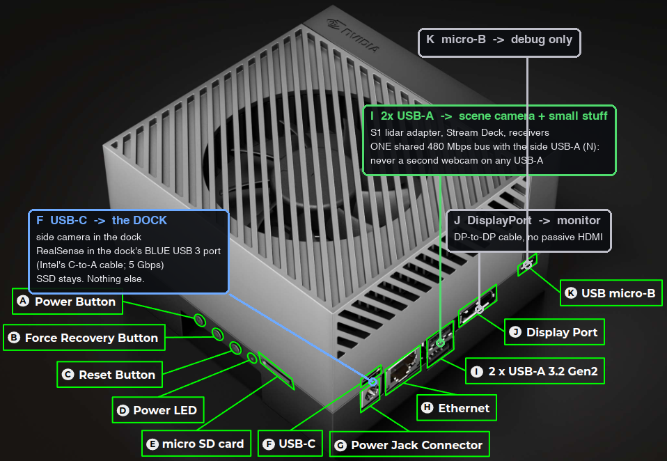
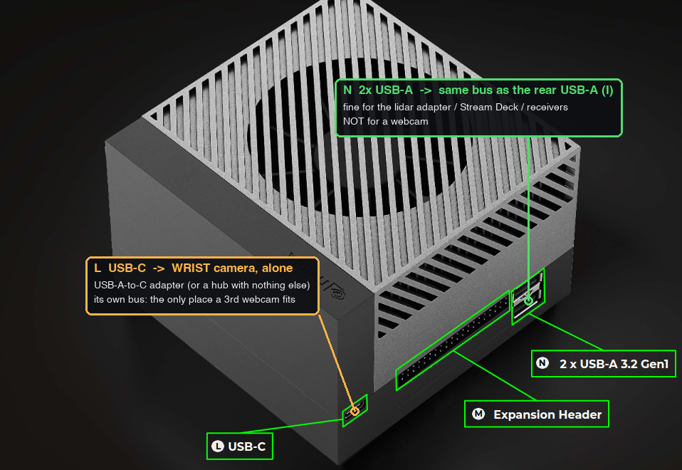
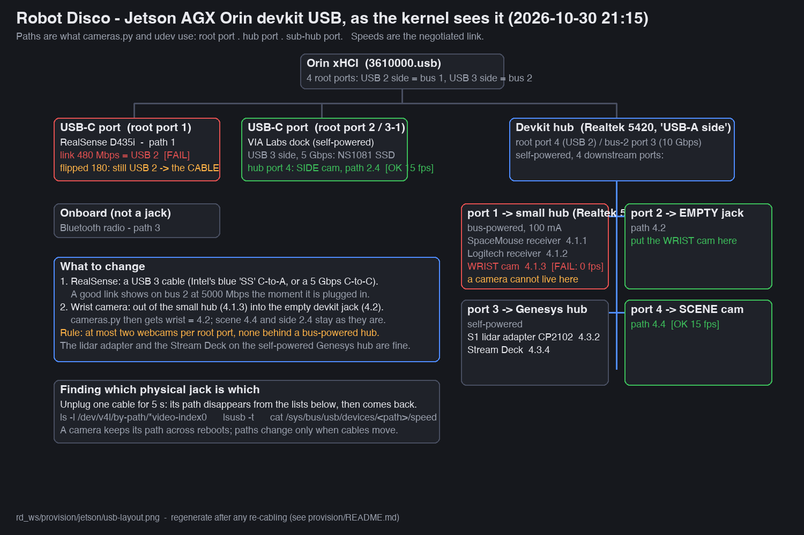

# Provisioning a Robot Disco robot PC

Everything needed to turn a fresh box into the robot PC ("RD", `rd@192.168.11.80`, ROS 2 Humble on
Ubuntu 22.04). Since 2026-10-10 the robot PC is a **Jetson AGX Orin** (JetPack 6.x), so the entrypoint is
`jetson/provision_jetson.sh`; it sources `provision.sh`, the shared phased installer that also provisions
an x86 box. The live robot is *not* git-synced and carries state that is not in this repo, so there is a
snapshot script as well:

| Script | Runs on | Purpose |
|---|---|---|
| `capture_rd_state.sh` | your workstation | Snapshot a working robot PC: installed packages, local edits, maps, learned faces, TTS cache, foxglove image. Doubles as a backup. |
| `jetson/provision_jetson.sh` | the robot PC (Jetson Orin) | **The normal path.** Sources `provision.sh`, adds the JetPack phases (`jetson`, `data`, CUDA torch in `vla`, `infer`, `vlamove`, `vlacheck`). See *Jetson Orin as the robot PC* below. |
| `provision.sh` | an x86 Ubuntu 22.04 box | The shared phased installer (idempotent, re-runnable, optionally restores from a snapshot); runs alone on an Intel box. |
| `deploy_to_rd.sh` | your workstation | Day-to-day push of the face, voice, route-runner and VLA code to a provisioned robot, then build + restart. See *Pushing changes to a provisioned robot* below. |
| `gpu/provision_gpu.sh` | the GPU box (Ubuntu 24.04, RTX 4090) | Training box + VLA web manager + the voice assistant's local LLM (Ollama under supervisor): venv, supervisor units, data from RD, optional Wi-Fi/desktop apps. See `gpu/README.md`. |

Manifests the installer reads: `apt-packages.txt`, `ros-packages.txt`, `pip-robot-face.txt`,
`pip-robot-face-tts.txt`, `pip-vla.txt`, `udev/99-robot-disco.rules`, `netplan/01-robot-disco.yaml`,
`start_face.sh`, `setup_kokoro.sh` (Kokoro-82M voice; offline wheel/model instructions in its header), `setup_faceid.sh` (ArcFace face recognition venv), `setup_voice.sh` (voice assistant: faster-whisper venv + anthropic SDK), `pulse/default.pa` (the PulseAudio output policy), `../src/robot_face/motions/wave.json` (the arm's wave, replayed on the UR5e). The supervisor units come from `../services/` (including `ollama.conf`, the local language model), the VLA units from `VLA/services/rd/`.

## 0. Before the old machine dies: take a snapshot

```bash
provision/capture_rd_state.sh            # -> provision/snapshot-YYYYMMDD/  (needs ssh host "RD")
```

Do this now, while the current RD still works. It is the only copy of the robot's uncommitted edits
(`rd_ws.local.diff`), the `zone_one` map, both face galleries (`people.json`, `people.arcface.json`) with
the Folks thumbnails, the arm gesture recordings, `~/Music` (skip with `NO_MUSIC=1`), `voice.env`, the Coqui
voice cache, the pip freezes (system python and `~/rd_ws/VLA/.venv`), `inventory/` (apt/ros package lists,
the installed supervisor confs, `pulse-default.pa`, the robot's `run.sh`, `ollama-models.txt`, `start_face.sh`)
and the foxglove image (skip with `NO_DOCKER=1`). Arguments: `capture_rd_state.sh [HOST] [OUT_DIR]`
(defaults `RD` and `provision/snapshot-YYYYMMDD`).
Commit anything from `rd_ws.local.diff` you want to keep; the rest can be re-applied with `git apply`.

## 1. Install Ubuntu 22.04 Desktop

On the Jetson this step is the SDK Manager flash (JetPack 6.x + Jetson runtime components, user `rd`); the
rest applies to both.

- Create user **`rd`** (the supervisor units, services and paths all assume `/home/rd`).
- Hostname `robotdisco`. Desktop (GNOME) is required: the face is an OpenGL window on the robot's screen.
- Enable OpenSSH during install or `sudo apt install openssh-server` afterwards.
- **Give the machine internet for provisioning** (any DHCP network, or a USB phone tether). The robot
  subnet `192.168.11.x` is isolated; moving onto it is the last step. If the box must already sit on
  the robot subnet, see *Provisioning without internet* below.

## 2. Run the installer

```bash
sudo apt install -y git
git clone https://github.com/r1b4z01d/rd_ws.git ~/rd_ws
~/rd_ws/provision/provision.sh all                      # ~30-60 min, mostly apt + colcon
sudo reboot                                             # groups + GNOME autologin take effect
```

Restoring from a snapshot copied to the new box (e.g. `scp -r provision/snapshot-20261008 rd@<ip>:~/`):

```bash
SNAPSHOT=~/snapshot-20261008 ~/rd_ws/provision/provision.sh all
cd ~/rd_ws && git apply ~/snapshot-20261008/rd_ws.local.diff   # the robot-only edits, if wanted
```

`all` runs: `preflight base ros groups udev sysctl workspace face audio services llm display foxglove`.
Each phase can be run alone and re-run safely, e.g. `provision.sh workspace` after fixing a build error;
`preflight` runs before any named phase.

| Phase | What it does |
|---|---|
| `preflight` | must run as `rd` with sudo; warns when the OS is not Ubuntu 22.04 or (x86 script) not amd64; writes the apt/pip/git proxy config when `PROXY` is set |
| `base` | `apt-packages.txt`; enables ssh, supervisor, docker; hostname; NTP; `/etc/hosts` entries for ur5e/amazinghand/gpu; `AUTHORIZED_KEY` |
| `ros` | ROS 2 apt repo, `ros-packages.txt`, rosdep; appends to `~/.bashrc`: source Humble + the workspace, `RMW_IMPLEMENTATION=rmw_cyclonedds_cpp` + `CYCLONEDDS_URI=~/rd_ws/services/cyclonedds.xml` (see *DDS transport*) and `ROS_DOMAIN_ID=0`; realsense udev rules |
| `groups` | adds `rd` to dialout, video, input, plugdev, audio, docker, render |
| `udev` | `udev/99-robot-disco.rules` (SpaceMouse hidraw, RealSense, webcams, gamepads) |
| `sysctl` | UDP receive buffers for the multicast camera stream (same file VLA's installer writes) |
| `workspace` | clones/updates `~/rd_ws` (`RD_WS_REPO`, `RD_WS_REF`), inits the `src/` submodules over https one at a time (a dead upstream is skipped; `SKIP_SUBMODULES=1` leaves an rsynced `src/` alone), applies `patches/<submodule>-*.patch` idempotently, restores `maps/` from the snapshot, `rosdep install`, `colcon build --symlink-install`. The `VLA/` submodule is not touched here (phase `vla`) |
| `face` | `pip-robot-face.txt` into the system python (`--user`); ArcFace face-ID venv via `setup_faceid.sh` (`WITH_FACEID=0` to skip); voice assistant venv + anthropic SDK via `setup_voice.sh` (`WITH_VOICE=0`, `WHISPER_MODEL=`); Kokoro-82M TTS via `setup_kokoro.sh` (`WITH_KOKORO=0`, `KOKORO_WHEELS=dir` for offline); `WITH_TTS=1` adds Coqui; installs the repo's arm gestures (`src/robot_face/motions/*.json` → `~/.robot_face/motions/`); restores Kokoro models, Coqui cache, both `people*.json` galleries, `faces/`, `motions/`, `~/Music` and `voice.env` from the snapshot (existing files win) |
| `audio` | `pulse/default.pa` → `~/.config/pulse/default.pa` (no auto-switch to a newly plugged device, no suspend-on-idle, default sink = `AUDIO_SINK`, the dock's C-Media adapter), unmutes the sink, `alsactl store` so the adapter does not come back muted at boot (see *Audio* below) |
| `services` | supervisor web UI / XML-RPC on `:9999` (no auth, trusted subnet), `Scripts/install_services.sh` (every `services/*.conf`, `ollama.conf` included, so the `ollama` unit exists before phase `llm` fills it) and `~/start_face.sh` |
| `llm` | the voice assistant's fallback language model on the robot: Ollama (installed if missing; the JetPack 6 build on the Orin), its installer's `ollama.service` disabled, **supervisor unit `ollama`** (`services/ollama.conf`: loopback `:11434`, user `ollama`, 30 min keep-alive), `ollama pull $OLLAMA_MODEL` (qwen2.5:7b, 4.7 GB, needs the uplink). `WITH_LLM=0` skips it. The GPU box's copy (`gpu/provision_gpu.sh llm`) is what the robot asks first |
| `display` | GDM autologin for `rd`, no screen blanking or lock |
| `foxglove` | `docker load` from `FOXGLOVE_IMAGE_TAR` or the snapshot, else builds `foxglove_studio/Dockerfile` (slow, needs internet) |
| `vla` | *(not in `all`)* `~/rd_ws/VLA/.venv` from the snapshot freeze or `pip-vla.txt`, `run.sh`, `install_services.sh rd` (camera service + ROS bridge, and the manual-start `vla_teleop` / `vla_eval` units with their `~/rd_ws/VLA/config/*.env` argument files) |
| `network` | *(not in `all`)* static `192.168.11.80/24` on `NET_IFACE` (auto-detected). netplan boxes: `netplan/01-robot-disco.yaml`, no gateway. A NetworkManager-managed interface (the Jetson desktop) is switched with `nmcli` instead, 2 s after the command returns (the SSH session drops): address, gateway `NET_GATEWAY` (192.168.11.1) and DNS `NET_DNS` (8.8.8.8) |

Environment knobs are listed at the top of `provision.sh`: `RD_USER`, `HOSTNAME_NEW`, `RD_WS_REPO`,
`RD_WS_REF`, `SNAPSHOT`, `SKIP_SUBMODULES`, `WITH_TTS`, `WITH_KOKORO` (+ `KOKORO_WHEELS` for an offline
install), `WITH_FACEID`, `WITH_VOICE` (+ `WHISPER_MODEL`, default `base.en`), `WITH_LLM` (+ `OLLAMA_MODEL`),
`AUDIO_SINK`, `FOXGLOVE_IMAGE_TAR`, `PROXY`, `AUTHORIZED_KEY`, `NET_IFACE`, `NET_GATEWAY`, `NET_DNS`,
`NETPLAN_RENDERER`. The Jetson script adds `JETSON_TORCH`, `JETSON_TORCHVISION`, `JETSON_PIP_INDEX`,
`CUSPARSELT_VERSION`, `SERVE_CKPT`, `NVPMODEL`, `DATA_LABEL`, `DATA_MOUNT`.

## 3. VLA (optional, only if this box also records/evaluates with the arm)

VLA is the `rd_ws/VLA` git submodule (`.gitmodules`, https://github.com/r1b4z01d/VLA; a `COLCON_IGNORE` in
it keeps colcon out). The robot has no internet, so `git submodule update` never runs there: the tree is
pushed from the workstation into the same place, `~/rd_ws/VLA`, and the robot's own `.venv`, `outputs/`,
`log/` and `config/*.env` live inside it untouched (the push never uses `--delete`). Then build the venv and
install the camera services:

```bash
# workstation, from rd_ws (needs the ssh host RD)
provision/deploy_to_rd.sh --vla
# or by hand, from rd_ws/VLA
tar czf - --exclude=__pycache__ --exclude=.venv --exclude=outputs ur5e_lerobot scripts services webui assets \
  | ssh rd@<new-rd> 'mkdir -p ~/rd_ws/VLA && tar xzf - -C ~/rd_ws/VLA'
# new robot PC
SNAPSHOT=~/snapshot-20261008 ~/rd_ws/provision/provision.sh vla
```

A robot provisioned before 2026-11-02 has the old layout, `~/VLA` beside `~/rd_ws`:
`jetson/provision_jetson.sh vlamove` moves it (Jetson table below) and `vlacheck` audits for leftovers.

## 4. Move onto the robot subnet (last)

```bash
NET_IFACE=enp3s0 ~/rd_ws/provision/provision.sh network     # NET_IFACE optional; auto-detects first en*/eth*
```

From the workstation, `ssh RD` should now work (the `RD` host entry in `~/.ssh/config` points at
`192.168.11.80` with `~/.ssh/alpha_id_rsa`; pass that public key as `AUTHORIZED_KEY` in step 2 or
`ssh-copy-id -i ~/.ssh/alpha_id_rsa.pub rd@<ip>` before switching).

## 5. Verify

```bash
sudo supervisorctl status            # route editor, collision monitor and ollama RUNNING; foxglove bridge/studio are manual-start
sudo supervisorctl status ollama && curl -s 127.0.0.1:11434/api/tags | head -c 200   # the local LLM answers
ls -l /dev/ttyTHS1 /dev/ttyUSB0      # RoboClaw (header UART, since 2026-11-08), RPLiDAR (dialout)
sudo dmesg | grep '3100000.serial'   # must say 'RX in PIO mode' (the PIO device tree is booted; see *RoboClaw on the header UART*)
rs-enumerate-devices | head          # RealSense seen
sudo supervisorctl start robot_face  # the face appears on the robot's screen (~/start_face.sh is the manual fallback)
sudo supervisorctl start robot_disco robot_disco_localization robot_disco_navigation && ros2 topic list | head
```

Then open the robot's own pages: `http://192.168.11.80:8092/?view=map` (the robot, both lidar scans and
the costmaps on the map) and `http://192.168.11.80:8092/3d` (the 3D view with the Velodyne cloud and the
URDF). Foxglove (`:8080`) is manual-start now and only needed for topics those pages do not draw.

## Pushing changes to a provisioned robot (`deploy_to_rd.sh`)

The robot is not git-synced: `deploy_to_rd.sh` is the way code gets there after provisioning (needs the
ssh host `RD`, i.e. the workstation on the robot network).

| Call | What it does |
|---|---|
| `provision/deploy_to_rd.sh` | rsyncs `src/robot_face/`, `src/robot_voice/`, `Scripts/path.py`, `src/robot_disco/scripts/ur_joint_state_publisher.py`, the face and voice units, the provision scripts and `README.md`; on RD `colcon build --packages-select robot_face robot_voice --symlink-install`, reinstalls the two units, restarts `robot_face`, starts or restarts `robot_voice`, waits 45 s and tails both logs; warns when `ANTHROPIC_API_KEY` is empty in `~/.robot_face/voice.env` |
| `… --setup` | additionally runs `setup_faceid.sh`, `setup_voice.sh base.en` and (if missing) `setup_kokoro.sh` on RD first (the first deploy on a fresh box) |
| `… --vla` | additionally pushes the VLA submodule tree (`rd_ws/VLA/` → `RD:~/rd_ws/VLA/`, no `--delete`; the robot's `.venv`, `outputs/`, `log/` and `config/*.env` are left alone) and runs `VLA/scripts/install_services.sh rd`, which re-reads `services/rd/*.conf` and restarts a running `vla_cameras` / `vla_camera_ros_bridge` only if its unit file changed. Refused while the robot still has the old `~/VLA` layout (run `vlamove` first) |

Everything else in `Scripts/` (the route editor, `record_path.py`, the YAML routes) and the other
`src/` packages still travel by hand (`rsync -a Scripts/ RD:rd_ws/Scripts/` and a `colcon build` for a
ROS package).

## Jetson Orin as the robot PC (`jetson/`)

Since 2026-10-10 the robot PC is a **Jetson AGX Orin dev kit** (64 GB), so the VLA inference server
runs on the robot's own GPU. `jetson/provision_jetson.sh` is the entrypoint: it sources `provision.sh` and
overrides only what differs on JetPack 6.x (Ubuntu 22.04, aarch64); `audio` and `llm` are inherited
unchanged. `all` = `preflight base jetson data ros groups udev sysctl workspace face audio services llm display foxglove`:

| Phase | Jetson difference |
|---|---|
| `preflight` | requires aarch64, `/etc/nv_tegra_release`, Ubuntu 22.04; prints L4T + CUDA versions |
| `base` | adds `jetson/apt-packages-jetson.txt` (boost, cmake, ninja, pkg-config, openblas, python3-dev for the source builds). Deliberately **not** `nvidia-jetpack`: the flash already has CUDA 12.6, cuDNN 9 and cuBLAS, and the metapackage would add several GB to the 64 GB eMMC |
| `jetson` *(new)* | power mode `NVPMODEL` (0 = MAXN) as the boot default in `/etc/nvpmodel.conf` plus `/var/lib/nvpmodel/status` (nvpmodel restores the last mode from there), a `jetson-clocks.service`, nvidia docker runtime as default, `jtop`, and `xpad` in `/etc/modules-load.d/xpad.conf` for the gamepad receiver, and the ttyTHS1 PIO device tree for the RoboClaw link (`uart1_pio_dtb`: stock DTB minus `serial@3100000` `dmas`/`dma-names`, booted via an `FDT` line in extlinux.conf, stock entry kept; see *RoboClaw on the header UART*) |
| `data` *(new)* | optional second drive (the 512 GB NVMe, ext4 label `data`): fstab `nofail` + mount at `/mnt/data`, then `~/rd_ws` (VLA inside it), `~/.cache/huggingface` and `~/.cache/robot_descriptions` become **symlinks** onto it (an existing tree is rsync-copied, checksum-verified and removed; refused while something runs from it), plus a `supervisor.service.d` drop-in so the units wait for the mount. No drive → no-op. |
| `vla` | cuSPARSELt (`CUSPARSELT_VERSION`, 0.7.1.0), then **torch 2.8.0 / torchvision 0.23.0 from `https://pypi.jetson-ai-lab.io/jp6/cu126`** (`JETSON_TORCH`, `JETSON_TORCHVISION`, `JETSON_PIP_INDEX`) (CUDA builds; PyPI torch has no Jetson CUDA), then `jetson/pip-vla-jetson.txt` = `lerobot[smolvla]==0.4.4` + the rest. `ur_rtde` and `moderngl` compile from source (no arm64 wheels). Asserts `torch.cuda.is_available()`. |
| `infer` *(new)* | `outputs/serve_ckpt` symlink (`SERVE_CKPT=`), installs `VLA/services/rd/vla_infer_server.conf` via `install_services.sh rd`; the same install drops `vla_teleop` / `vla_eval` (manual start: `sudo supervisorctl start vla_teleop`, arguments in `~/rd_ws/VLA/config/teleop.env` / `eval.env`) |
| `vlamove` *(new)* | one-time, for a robot provisioned with the old layout (`~/VLA` beside `~/rd_ws`): stops the `vla_*` units, renames `/mnt/data/VLA` to `/mnt/data/rd_ws/VLA` (same filesystem: the 8 GB of outputs stay put), removes `~/VLA` (no compatibility link), patches the venv's absolute shebangs in place (no internet to rebuild it), makes `outputs/serve_ckpt` relative, reinstalls the units from the rewritten `services/rd/*.conf` (push the tree first; refused while a conf still says the old path) and restarts `robot_voice` / `robot_face` / the route editor. Idempotent. Rollback: `sudo mv -T /mnt/data/rd_ws/VLA /mnt/data/VLA && ln -s /mnt/data/VLA ~/VLA`, reverse the sed on `.venv/bin/*`, `sudo cp /etc/supervisor/conf.d.pre-vlamove/vla_*.conf /etc/supervisor/conf.d/` + `reread`/`update` |
| `vlacheck` *(new)* | prints everything on the box that still names `~/VLA` / `/home/rd/VLA` (installed units, the venv, both trees, `~/.bashrc`, crontab); nothing printed = clean |
| `foxglove` | always an arm64 build; refuses to trust an x86 tarball |
| `network` | the Jetson desktop runs NetworkManager, so the address is set with `nmcli` (`NET_GATEWAY`, `NET_DNS`); `NETPLAN_RENDERER` defaults to `NetworkManager` for the netplan fallback |

```bash
# flash with SDK Manager: JetPack 6.x + Jetson runtime components, user rd
git clone https://github.com/r1b4z01d/rd_ws.git ~/rd_ws
~/rd_ws/provision/jetson/provision_jetson.sh all        # preflight base jetson data ros ... foxglove
sudo reboot
# push the VLA tree (section 3: deploy_to_rd.sh --vla from the workstation), then
SNAPSHOT=~/snapshot-20261008 ~/rd_ws/provision/jetson/provision_jetson.sh vla infer
~/rd_ws/provision/jetson/provision_jetson.sh network
```

Driving with the local server (same split as before, just over loopback, so `--prefetch --rtc` and
`--n-action-steps` keep living in the unit file):

```bash
rsync -a gpu:VLA/outputs/train/<run>/checkpoints/last/ ~/rd_ws/VLA/outputs/train/<run>/checkpoints/last/
ln -sfn ~/rd_ws/VLA/outputs/train/<run>/checkpoints/last/pretrained_model ~/rd_ws/VLA/outputs/serve_ckpt
sudo supervisorctl start vla_infer_server
~/rd_ws/VLA/run.sh scripts/eval_hw.py --remote 127.0.0.1:8777 --cameras udp --fps 12 --video
```

Jetson-specific caveats:
- The torch pins are deliberate: lerobot 0.4.4 wants `torch<2.11`, and the 2.9+ wheels on the Jetson index
  additionally need cuDSS. Override with `JETSON_TORCH=` / `JETSON_TORCHVISION=` if the index moves on.
- An x86 snapshot's `vla-venv-freeze.txt` is reused minus torch/CUDA/x86-only lines; a few pins may still
  fail on aarch64, which the script reports and then falls back to the loose list.
- Coqui TTS (`WITH_TTS=1`) is untested on aarch64; the face falls back to espeak without it.
- `mediapipe` ships arm64 wheels, `moderngl` and `ur_rtde` build from source (several minutes), `glfw`
  uses the apt `libglfw3`.
- No AMD64-only assumptions remain in `services/*.conf`; the Foxglove image is the only thing that
  must be rebuilt for arm64.

Verified on an AGX Orin dev kit (JetPack 6.2, L4T r36.5.2, CUDA 12.6) on 2026-10-10; the fixes that
run needed are now in the scripts:
- JetPack images ship Docker CE, so `docker.io` is only installed when no docker is present.
- `robot_disco`'s CMake installs a `worlds/` directory git never tracked; `worlds/.gitkeep` fixes the
  symlink-install build.
- ROS setup files trip `set -u`; the installer relaxes it around `source`.
- `AprilTag_Detection`'s upstream repo is gone; submodules are now fetched one by one and a dead one
  is skipped (it is a demo package, nothing launches it).
- **Two OpenCVs in one process (2026-11-01).** JetPack's `libopencv-dev` is NVIDIA's 4.8.0, but the
  apt `ros-humble-cv-bridge` and `image_geometry` were built against Ubuntu's 4.5.4 (`libopencv-core4.5d`
  stays installed beside it). A C++ node that uses cv_bridge and is built in the workspace therefore
  links OpenCV 4.8 directly and 4.5 through cv_bridge, and the `cv::Mat` cv_bridge returns aborts the
  process: `OpenCV(4.8.0) ... Assertion failed s >= 0 in function 'setSize'` — that killed the
  `apriltag_ros` component container on its first camera frame. `patches/apriltag_ros-single-opencv.patch`
  drops cv_bridge/image_geometry from that node (own mono8 conversion, intrinsics read from
  `CameraInfo`); `provision.sh workspace` applies every `patches/<submodule>-*.patch` idempotently.
  Python nodes are unaffected (cv_bridge's Python path goes through NumPy). `ldd <lib> | grep opencv`
  showing both `.so.408` and `.so.4.5d` is the tell.
- Kokoro TTS: onnxruntime ≥ 1.20 aborts on the Orin (cpuinfo assertion); `setup_kokoro.sh` pins
  1.18.1 on aarch64.
- NVIDIA's torch wheel is built against NumPy 1.x, but lerobot's rerun-sdk declares numpy 2, so the
  venv is installed with numpy 2 and then downgraded to `numpy<2` as a post-step (extensions built
  against numpy 2 run on 1.26; only `pip check` complains). `opencv-python<4.13` matches lerobot's
  headless pin.
- cuDNN 9, cuBLAS and the CUDA toolkit come with the flash; only cuSPARSELt was missing, installed from
  NVIDIA's redist tarball. `nvidia-jetpack` is deliberately not installed (several GB on the 64 GB eMMC).
- MAXN cannot be switched live (nvpmodel asks for a reboot), so the boot default in
  `/etc/nvpmodel.conf` is set instead and takes effect at the post-provisioning reboot.
- **USB layout matters.** The dev kit's four USB-A ports sit behind two internal hubs, each with its
  own 480 Mbit/s USB 2.0 budget; an external hub puts everything behind one. Two of the wide-FOV
  webcams on the same hub cannot stream together at any resolution (`Not enough bandwidth for
  altsetting` in dmesg; the uvcvideo bandwidth quirk does not help). Put the scene and wrist cameras
  on different root ports, and give the RealSense a USB 3 port + cable (on USB 2.1 it reports
  "Reduced performance" and limits depth).
- `ur_description` 2.13 (apt) emits a ros2_control block from `ur_macro.xacro` by default; the base
  description passes `generate_ros2_control_tag="false"` so the base controller_manager does not try
  to open the arm (the `robot_disco_ur5e_driver` service owns it).
- `git submodule update --init` can leave a submodule directory empty while reporting it checked out
  (seen after a partial run); `--force` restores the files. `provision.sh workspace` warns on empty dirs.
- The 8BitDo Ultimate 2C gamepad (2.4 GHz receiver) in X-input mode shows up as `2dc8:310a` with
  an Xbox 360 class interface, which xpad on kernels before 6.10 does not list; a udev rule in
  `udev/99-robot-disco.rules` registers the ID with xpad so `/dev/input/js0` appears for joy_node.
  **2026-10-31:** binding is not enough — the receiver sends nothing until xpad sends it the Xbox
  LED command, and JetPack's xpad is built without LED/rumble output. Build and install the module
  from `xpad/` (`xpad/install.sh --reload`; re-run after every kernel update), see `xpad/README.md`;
  joy then sees the pad as "8BitDo Ultimate 2C Wireless Controller" (config/joystick.yaml).
  The controller must be in X-input mode (keyboard/mouse mode only yields a Keyboard + Mouse device).
- `foxglove_bridge` comes from `src/foxglove_bridge` (C++ 0.8.5 submodule), not apt: the apt 3.x
  Rust bridge only accepts the `foxglove.sdk.v1` subprotocol, and the vendored Studio 1.87 speaks
  `foxglove.websocket.v1`, so every browser connection was dropped with "handshake failed".
- **Clock.** The AGX Orin dev kit has no battery-backed RTC: after a power cut it boots in 1970 and
  stays there until chrony reaches a server through the subnet gateway. Everything TLS then fails
  ("certificate is not yet valid": pip, curl, HF). Seen 2026-10-11 after a network outage. If the
  uplink is down, set it by hand (`sudo date -u -s "<UTC from a good clock>"`) and check
  `timedatectl` says synchronized once the link is back.
- Stream Deck: the `streamdeck` pip package uses hidapi's libusb backend, so it needs
  `libhidapi-libusb0` (apt list) and a udev rule on the USB device node (udev file), not just hidraw.
- The UR5e in the base description is animated by `robot_disco/scripts/ur_joint_state_publisher.py`
  (read-only RTDE poll into `/joint_states`, launched by `launch_robot.launch.py`); it needs `ur_rtde`
  in the system python (`pip-robot-face.txt`).
- A SmolVLA checkpoint needs its base VLM (`vlm_model_name` in the checkpoint's `config.json`,
  HuggingFaceTB/SmolVLM2-500M-Video-Instruct) in `~/.cache/huggingface/hub`; the unit runs offline.
  `provision_jetson.sh infer` downloads it while the box still has internet; on the robot subnet copy
  the `models--HuggingFaceTB--*` folder from the GPU box instead.

## RoboClaw on the header UART (since 2026-11-08)

The base's RoboClaw 2x15A (firmware 4.3.6) no longer hangs off USB: its USB jack is mechanically bad
(enumerates only when pressed; "device descriptor read/64, error -32" on every Jetson port), and when it
was moved from its own battery to a DC-DC converter shared with the audio amp, plugging that USB in
reset the Jetson twice (ground offset through the cable). It now talks packet serial on the Jetson's
40-pin header: **pin 8 (TX) -> S1, pin 10 (RX) <- S2, pin 6 GND**, 3.3 V levels, `/dev/ttyTHS1`
(`serial@3100000`, `uarta`; `config-by-pin.py -n 1 -p 8` says `uarta`). Three things make it work:

1. **RoboClaw config**: packet serial mode (7 = address 0x80), 115200, plus a 0.5 s serial timeout as a
   watchdog (the board otherwise keeps the last speed when the link dies). The board had been in RC mode
   (S1/S2 are servo inputs there; USB ignored the mode, so nobody noticed). Set with the buttons
   (MODE -> SET to 7 -> LIPO; same for the baud menu, option 6) or over any serial link with
   `provision/tools/roboclaw_config.py` (on the robot: `~/rd_ws/provision/tools/`; `--set-mode packet --set-baud 115200 --set-addr 128
   --timeout 5 --save`; cmd 94 "write EEPROM" is not acknowledged by firmware 4.3.6, so check after a
   power cycle). `provision/tools/roboclaw_probe_uart.py /dev/ttyTHS1 115200` is the link test (`uart_capture.py` shows
   the raw reply, `uart_loopback.py` checks pins 8/10 with a jumper).
2. **Jetson device tree** (phase `jetson`, `uart1_pio_dtb`): on JetPack 6 the UART's receive DMA returns
   zeroed bytes (the reply has the right length and framing, DMA-read bytes are 0x00; NVIDIA forum
   "DMA on /dev/ttyTHS1 corrupts receiving data"). `ttyTHS2` ships without DMA bindings and is fine, so
   the stock `/boot/dtb/kernel_tegra234-*.dtb` is copied to `...-uart1-pio.dtb` with `dmas`/`dma-names`
   removed from `serial@3100000` and booted via an `FDT` line in `/boot/extlinux/extlinux.conf` (what
   jetson-io does; the `stock` entry stays as a fallback). `dmesg | grep 3100000.serial` must say
   `RX in PIO mode`. Regenerate the copy after a kernel/dtb package update (the phase does when the
   stock file is newer).
3. **Driver patches** (`patches/roboclaw_serial-baud-rate.patch`,
   `patches/roboclaw_hardware_interface-baud-rate.patch`, applied by `workspace`): a `baud_rate`
   hardware parameter (the upstream driver never set the tty speed, USB CDC did not care), a failed open
   fails `on_init` instead of aborting controller_manager on the first read, and a reply is read until
   the line goes quiet (USB delivered a reply in one `read()`, a UART delivers it in pieces, which the
   CRC check then rejected). `robot_disco/description/ros2_control.xacro` carries
   `serial_port=/dev/ttyTHS1`, `baud_rate=115200`.

Traps: never open a `ttyTHS*` below 9600 baud. The Tegra driver enables the FIFO before it sets the
speed on the next open, and a 2400-baud leftover (uart clock 38400 Hz) makes every open fail with
`Failed to enable FIFO mode: -110` until `echo 1843200 | sudo tee /sys/kernel/debug/bpmp/debug/clk/uarta/rate`
(no reboot needed). After a RoboClaw link loss the controller manager still has to be restarted by hand
(`sudo supervisorctl restart robot_disco`); `launch_robot.launch.py` deliberately does not respawn it.

## Provisioning without internet (box already on the robot subnet)

`apt`, `pip` and `git` can be tunnelled through the workstation over SSH. On the workstation:

```bash
ssh -R 1080 rd@192.168.11.80          # OpenSSH >= 7.6: remote dynamic (SOCKS) forward
```

In that session on the robot PC:

```bash
PROXY=socks5h://127.0.0.1:1080 ~/rd_ws/provision/provision.sh all
```

`preflight` writes the apt proxy config and exports `ALL_PROXY`/`PIP_PROXY`; `network` removes the
apt config again. The docker daemon does **not** use it, so bring the foxglove image as a tarball
(from the snapshot, or `docker build -t robotdisco/foxglove foxglove_studio/ && docker save ...` on a
machine with internet) and pass `FOXGLOVE_IMAGE_TAR=`.

## Audio

Speaker: the dock's **C-Media USB audio adapter** (PulseAudio sink `alsa_output.usb-C-Media_Electronics_Inc._USB_Audio_Device-00.analog-stereo`);
microphone: the **TONOR G11** (robot_voice's ears pick it by name and re-open it when it is power-cycled).
No Bluetooth. Three ways the robot went silent, all handled by `provision.sh audio` and the nodes:

- **Auto-switch**: stock PulseAudio loads `module-switch-on-connect`, so plugging any USB audio device made
  it the default output. `pulse/default.pa` unloads it (and `module-suspend-on-idle`, which clipped the
  first syllable of every sentence).
- **Boot race**: the adapter enumerates after PulseAudio starts, so `set-default-sink` in `default.pa`
  can miss it and `module-default-device-restore` keeps the onboard jack. The face node's `SinkWatchdog`
  (`audio_sink: C-Media`) re-asserts the default every 5 s, and every player the nodes spawn (`aplay`,
  `ffplay`, the chime) is pinned with `PULSE_SINK`, so sound lands on the adapter either way.
- **Muted at boot** (2026-10-31): once the adapter's hardware mute had been set, `/var/lib/alsa/asound.state`
  held it and udev's `alsactl restore` re-muted it at every boot. The phase unmutes and runs `alsactl store`.

Volume is the sink's volume (`pactl set-sink-volume`, or "Robot Disco, volume 50 percent"); music is a
separate sink input that the voice node ducks to `music_duck` while it listens and speaks.

## DDS transport

Every ROS unit (and rd's shell) uses Cyclone DDS: `RMW_IMPLEMENTATION=rmw_cyclonedds_cpp` and
`CYCLONEDDS_URI=file:///home/rd/rd_ws/services/cyclonedds.xml` (localhost-only, unicast discovery, 120
participant slots). Fast DDS had one real failure mode on this robot: shared-memory segments left stale after
unit restarts (2026-10-27: Nav2 lost the map frame, AMCL ignored the initial pose; UDP-only fixed that). The
2026-11-03 switch to Cyclone was made while chasing "controller_server stops receiving AMCL's map->odom", which
turned out to be a tf2_ros deadlock (0.25.21-0.25.23, geometry2 #992; fixed by `ros-humble-tf2`/`tf2-ros`
0.25.24, see *tf2 deadlock* below), not DDS. Cyclone stayed because it works. `services/fastdds_no_shm.xml` stays as the fallback:
put `FASTRTPS_DEFAULT_PROFILES_FILE` back in the units instead of the two Cyclone variables. Cyclone and
Fast DDS do not interoperate, so switch every unit and shell together. Needs `ros-humble-rmw-cyclonedds-cpp`
(in `ros-packages.txt`).

## tf2 deadlock (ros-humble-tf2 0.25.21-0.25.23)

Symptom: minutes after a navigation restart, usually while driving, a goal fails with `controller_server`
logging "Transform data too old when converting from map to odom" every cycle (or "Reached the goal!" at once,
then the recovery spin runs forever = "the robot keeps turning right"), while AMCL publishes normally and the
planner still plans. Cause: an ABBA deadlock inside tf2 between the TransformListener thread
(`testTransformableRequests`) and the costmap's scan `MessageFilter` (`waitForTransform`); the whole TF buffer
of that process freezes (gdb: two threads parked on two mutexes of the same `tf2_ros::Buffer`). Fixed upstream
in tf2/tf2_ros 0.25.24 (geometry2 #992 / #990). Keep those two packages at >= 0.25.24 (they are in
`ros-packages.txt` by name, so a fresh provision gets the current version); any process with a MessageFilter
(planner, controller, collision monitor) can hit it.

## Known gaps / things to confirm against the snapshot

- The vendored `foxglove_studio/` tree was missing its `packages/log` workspace because the top-level
  `.gitignore` ignores any `log/` directory; it is restored (from Lichtblick's `1.86.0-fork-dev`, the
  Studio 1.86 fork point, pinned to this repo's yarn.lock) and un-ignored. The Dockerfile uses a
  heredoc, so it needs BuildKit: on the Mac that is colima + the `docker-buildx` brew plugin
  (`docker buildx build --platform linux/arm64 --load ...`, ~7 min on an M2).
- The Foxglove image is tagged `robotdisco/foxglove` (docker rejects uppercase repository names; the
  unit used to say `RobotDisco/foxglove`, which docker parsed as a registry host). Build it with
  `docker build --platform linux/arm64 -t robotdisco/foxglove foxglove_studio/` on an arm64 Mac
  (colima) and ship it with `docker save robotdisco/foxglove | ssh RD docker load`, or run
  `provision_jetson.sh foxglove` on the robot.
- The RealSense **T265** is unsupported by librealsense ≥ 2.54 (what the Humble apt wrapper ships).
  If T265 odometry is actually used, pin `ros-humble-librealsense2`/`realsense2-camera` to a 2.53.x
  build or build from source.
- `start_face.sh` here is a reconstruction of the one living on RD; the snapshot keeps the original in
  `inventory/start_face.sh`, diff them once.
- Python pins for `robot_face` (`mediapipe`, `moderngl`, `glfw`) and the VLA venv are unpinned in the
  manifests on purpose; the snapshot freezes are the authoritative versions.
- The AmazingHand runs on its own host (`192.168.11.117` / `192.168.1.194`); nothing from
  `AmazingHand-main/` is installed on the robot PC.

## USB layout on the Jetson (2026-10-30)




(Port photos: RidgeRun's labelled AGX Orin devkit images, annotated.) The four USB-A jacks (rear I and
side N) all hang off the devkit's one onboard hub = ONE 480 Mbps USB 2 bus; only one of these webcams
fits there at 1280x720 (verified 2026-10-30: the second one's stream-on fails with ENOSPC, hub or no
hub, and the uvcvideo FIX_BANDWIDTH quirk only helps at 640x480). The two USB-C ports are separate
root ports. Final cabling (2026-10-30): scene in the dock on USB-C F (path 1.1; the RealSense on the
dock's USB 3 port via Intel's C-to-A cable, 5 Gbps), wrist alone on USB-C L (path 2), side on a USB-A
jack (path 4.2) with the lidar adapter, Stream Deck and receivers.



What `cameras.py` keys on is the USB *port path* (`platform-3610000.usb-usb-0:<root>.<hub>.<sub>`), so a
camera keeps working across reboots but not across re-cabling. Rules learned on this box: at most two
webcams per root port (each reserves its full USB 2 alt-setting), none behind a bus-powered hub; the
RealSense needs a true USB 3 link (5000 Mbps on bus 2) or its depth+colour profile fails. After any re-cabling: `ls -l /dev/v4l/by-path/*video-index0`, grab a lit frame per port, update
`_PORTS` in `VLA/ur5e_lerobot/sensors/cameras.py`, restart `vla_cameras` (the camera ROS bridge
follows by itself since VLA 2747290; restart it only if it was started before the network came up).

## Disk layout on the Jetson (since 2026-10-26)

The 64 GB eMMC is the system disk and was filling up, so a 512 GB NVMe (ext4, label `data`) is mounted
at `/mnt/data` and `provision_jetson.sh data` keeps the big trees there behind symlinks:

| in the home | on the drive |
|---|---|
| `~/rd_ws` (VLA inside it, as `rd_ws/VLA`) | `/mnt/data/rd_ws` |
| `~/.cache/huggingface` (base VLM, LeRobot's Arrow copies) | `/mnt/data/cache/huggingface` |
| `~/.cache/robot_descriptions` (robot meshes) | `/mnt/data/cache/robot_descriptions` |

Everything in this kit, the supervisor confs, the venv shebangs and the workstation's rsync targets keep
using `/home/rd/...`, which resolves through the links. The fstab entry is `nofail` (the robot boots
without the drive), so the phase also installs `/etc/systemd/system/supervisor.service.d/nvme-data.conf`
(`RequiresMountsFor=/mnt/data`): without it supervisor's autostart units would start into empty symlink
targets. The phase is idempotent; on a box that already has the drive it only verifies. To migrate a
live box, stop the units that run from the trees first (`vla_cameras`, `vla_camera_ros_bridge`,
`robot_disco_*`), as the phase refuses to move a tree that is in use. `DATA_LABEL` / `DATA_MOUNT`
override the defaults.

## Robot web pages (route editor, port 8092)

`Scripts/route_editor.py` runs as the supervisor unit `robot_disco_route_editor` (autostart) and serves,
with no internet needed on the robot:

| URL | what |
|---|---|
| `http://192.168.11.80:8092/` | route editor: map + 1 m grid, live robot pose, click/drag waypoints, pause + post_actions per waypoint, undo, check / centre / densify, save for `path.py` |
| `…:8092/?view=map` | 2D map view: filtered RPLiDAR scans, Velodyne top-down, global/local costmap overlays (the local one placed through map→odom), legend; tool bar **Pan / Nav Goal / Initial Pose** (click, drag for the heading, release publishes `/goal_pose` or `/initialpose` through `POST /api/publish`); press-and-hold a layer's swatch to recolour it (remembered per browser) |
| `…:8092/api/landmarks` | named places with a photo (`GET` list; `POST` add at the robot's pose / rename / recapture / update pose / `DELETE`; `…/<id>/tasks` add / edit / remove a policy run tied to the place; `POST …/<id>/run` hands a task to the voice assistant). Kept in `Scripts/landmarks/landmarks.yaml` + `img/`; the manager's **Landmarks** tab is the UI |
| `…:8092/api/apriltags` | the taught AprilTag map poses (from the relocalizer's file, `--apriltags-file`) and the tags in view; drawn by the 3D page's **AprilTags** layer (taught = amber, seen = green) |
| `…:8093/cam/<scene|side|wrist|realsense>.mjpg` | camera feeds as MJPEG on a second port (`--cam-port`, default port+1: browsers allow ~6 connections per host:port and four open streams would starve the pages' own requests) (the three VLA cameras via `scripts/camera_ros_bridge.py`'s `/vla/cameras/<name>/image/compressed`, the RealSense via `/camera/camera/color/image_raw/compressed`); `.jpg` = one frame; both pages show them as a strip on the right (checkbox per feed, click to enlarge) |
| `POST …:8092/api/halt` | the pages' **HALT** button: cancels every nav2 goal, sends zero velocity (joystick mux input + wheel controller), SIGTERMs path.py / vla_action / eval_hw (the eval's clean EXIT powers the UR down) and stops the `vla_eval` unit; teleop is left alone. In `--sim` it latches until RESUME |
| `…:8092/3d` | 3D view replacing Foxglove's 3D panel: map plane, costmaps, Velodyne / RPLiDAR clouds, the URDF robot model with live joints (meshes served from the package share dirs), TF frames, nav2 plans / goal / footprint / stop and slowdown polygons (filled when tripped), AMCL particles, AprilTags, the route, follow-robot camera, click tools publishing `/goal_pose` and `/initialpose`. The side panel folds as accordions (Scene / Sensors / Robot / Navigation / Cameras / Simulation / View point, remembered per browser), the camera panels fold and resize, the tool bar floats; HALT at the bottom |
| `http://192.168.11.80:8096/` | **Folks**: robot_face's page of the people the robot knows (served by the face node, embedded by the manager's Folks tab) |


**Developing without the robot:** the manager's Map tab has a live / sim switch; choosing sim starts
`route_editor.py --sim` on the manager's own host (port 8094, cameras on 8095) and live stops it again.
`Scripts/dev_stack.sh start` brings up the whole GUI on a laptop in one go — the editor in `--sim`
(:8094), the teleop panel with the MuJoCo arm and on-screen sliders (:8090), and the VLA manager (:8081)
wired to both; `stop` / `status` / `logs` likewise. By hand:
`cd rd_ws/Scripts && python3 route_editor.py --sim --port 8094` serves the same
pages on a laptop with a simulated robot driving the route (`--sim-route NAME`): scans and a Velodyne
cloud raycast against the map, costmaps, TF, joints, plans, goal/initial-pose tools, the URDF
(`sim/robot_sim.urdf` primitives, or the real model after `sim/fetch_assets.sh` with the robot on).
Movable cones (3D page: `cone` tool drops one, drag to move, shift-click removes; `+ cone ahead`) are seen
by the simulated lidars / Velodyne / cameras, marked in both costmaps and trip the stop / slowdown zones;
the sim robot plans around them (A* on the inflated costmap, replanned every second like nav2, inscribed cells passable at a steep price, a waypoint that stays unreachable is skipped) and stops or slows like the collision monitor when something is in its zones. Needs only numpy, Pillow and PyYAML. The manager follows with
`python -m webui.server --port 8081 --route-url http://127.0.0.1:8092/`.

The VLA manager embeds the last two as its Map and 3D tabs. three.js 0.182 and urdf-loader 0.12.6 are
vendored under `Scripts/static/vendor/` (licenses there); upgrade by copying the same files from a
`node_modules` tree.
