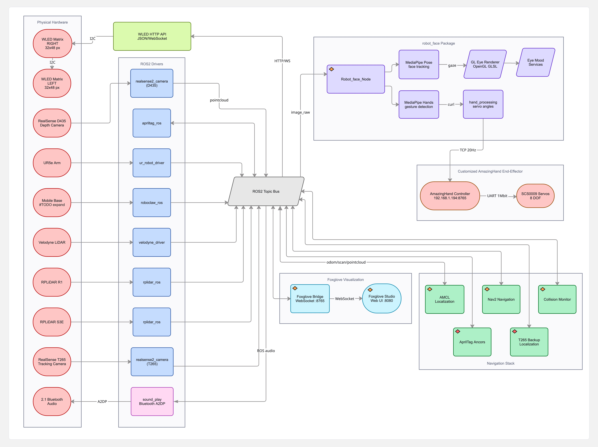

# Robot Disco - ROS2 Workspace



*The diagram dates from 2026-04 and has not kept up: the T265, the Bluetooth speaker and the TCP hand relay are gone; the Jetson Orin robot PC, the route editor pages, the voice assistant, the VLA submodule and the GPU box are missing from it.*

A ROS 2 Humble workspace for Robot Disco: a differential-drive mobile robot (RoboClaw base, RPLiDAR S1 + S2E and a Velodyne for navigation, a RealSense D435 for AprilTag relocalization) carrying a UR5e arm with the 8-DOF AmazingHand, an animated face on a portrait display, a microphone and a USB speaker. The robot PC has been an NVIDIA Jetson AGX Orin (Ubuntu 22.04, 512 GB NVMe at `/mnt/data`) since 2026-10-10; it also runs the VLA policy inference server. A separate GPU box (RTX 4090, `192.168.11.119`) trains policies and hosts the web manager. What lives here:

- **Navigation**: `robot_disco` (bringup, AMCL / slam_toolbox, Nav2, the collision monitor, AprilTag relocalization) and the browser pages in `Scripts/` (route editor, 2D map, 3D view, landmarks, cameras, HALT), plus `path.py`, the route runner that drives waypoints and runs arm policies at them.
- **The face**: `robot_face`, GPU-rendered eyes and a speech-driven mouth, on-robot face recognition that learns who it meets, Kokoro speech, a UR5e wave with a finger wiggle, and the Folks web page.
- **The voice**: `robot_voice`, the "Robot Disco, …" wake phrase, Whisper ears, Claude or a local Ollama model as the brain, and skills (weather, news, Home Assistant, music, volume, navigation, landmark tasks).
- **VLA**: the `VLA/` git submodule (LeRobot teleop and recording, SmolVLA training on the GPU box, the inference server on the robot, the camera service, the web manager). Its own docs are `VLA/README.md` and `VLA/wiki/`.
- **Provisioning and deployment**: `provision/` rebuilds a robot PC or the GPU box from scratch; `provision/deploy_to_rd.sh` is how code reaches the robot (it is not git-synced).

## Pages

- [Robot-Face](Robot-Face): the animated face, face recognition, Kokoro speech, the UR5e wave, the Folks page, and how to run and drive it.
- [Robot-Voice](Robot-Voice): the "Robot Disco, ..." voice assistant.
- [Robot-Disco-Base](Robot-Disco-Base): the mobile base package (bringup, Nav2, maps, joystick, AprilTag relocalization).
- [Route-Editor-and-Path-Runner](Route-Editor-and-Path-Runner): the browser pages, recording a route, the waypoint runner and VLA actions.
- [Hardware-Bringup](Hardware-Bringup): the UR5e, transforms, the RealSense, the navigation stack, maps, utilities.
- [AmazingHand](AmazingHand): the 8-DOF hand.
- [Third-Party-Packages](Third-Party-Packages): apriltag, roboclaw, the lidar drivers and the VLA submodule.
- [Hardware-Peripherals](Hardware-Peripherals): the WLED panels, audio, the retired T265.
- [Supervisor-Services](Supervisor-Services): every supervisor unit, install and `supervisorctl` recipes.
- [Foxglove-Studio](Foxglove-Studio): the Foxglove fork, custom panel, layout and Docker setup (manual start).
- [Provisioning-and-Deploy](Provisioning-and-Deploy): rebuild a robot PC from scratch and push code to the robot.
- [Build-and-Run](Build-and-Run): the colcon build.

The VLA subproject has its own wiki: [r1b4z01d/VLA](https://github.com/r1b4z01d/VLA/wiki).

## Workspace Structure
```
rd_ws/
├── src/
│   ├── robot_face/             # Animated face (eyes + mouth), face recognition, Kokoro speech, UR wave, Folks page (active)
│   ├── robot_voice/            # "Robot Disco, …" voice assistant: Whisper ears, Claude / Ollama brain, skills, landmark tasks (active)
│   ├── robot_disco/            # Mobile base: bringup, nav2, maps, joystick, AprilTag relocalization (submodule, r1b4z01d/Robot_Disco)
│   ├── apriltag/               # AprilTag C library (submodule)
│   ├── apriltag_ros/           # ROS2 AprilTag wrapper (submodule; patched on the Jetson, see provision/patches/)
│   ├── AprilTag_Detection/     # AprilTag demo package (submodule; its upstream is gone, left empty on new boxes)
│   ├── foxglove_bridge/        # Foxglove WebSocket bridge (submodule)
│   ├── pyDHgripper/            # DH gripper library (submodule, unused on the robot)
│   ├── roboclaw_hardware_interface/  # RoboClaw ros2_control HW interface (submodule)
│   ├── roboclaw_serial/        # RoboClaw serial library (submodule)
│   ├── roboclaw_ros/           # RoboClaw ROS2 node (submodule)
│   ├── norlab_custom_interfaces/    # Custom ROS message types (submodule)
│   ├── velodyne/               # Velodyne 3D LiDAR driver (submodule)
│   └── rplidar_ros/            # RPLiDAR 2D driver (submodule)
├── VLA/                        # LeRobot teleop/recording, SmolVLA training + inference, camera service, web manager (submodule, r1b4z01d/VLA)
├── AmazingHand-main/           # The 8-DOF hand: CAD, ESP32 firmware (UDP/TCP line protocol), demos (submodule, r1b4z01d/AmazingHand)
├── Scripts/                    # Browser pages + tools (no ROS package):
│   ├── route_editor.py / .html #   route editor, 2D map (?view=map), landmarks + tasks API, cameras, HALT (unit robot_disco_route_editor, :8092)
│   ├── map3d.html, static/     #   the 3D view (/3d; three.js + urdf-loader vendored, cams.js, swatches.js)
│   ├── sim_robot.py, sim/      #   `route_editor.py --sim`: a simulated robot + sensors from the map alone (URDF, meshes via fetch_assets.sh)
│   ├── path.py                 #   waypoint runner: Nav2 FollowWaypoints + post_actions (shell, pause, vla: policy runs)
│   ├── record_path.py          #   record a route by driving; simplify / center / densify
│   ├── dev_stack.sh            #   the whole GUI on a laptop: sim editor + MuJoCo teleop panel + manager
│   ├── landmarks/              #   landmarks.yaml + img/ (created by the editor; photos are git-ignored)
│   ├── *.yaml, *.svg           #   routes (waypoints.yaml, tigger_route.yaml, …) and their recorded traces
│   ├── install_services.sh     #   installs services/*.conf into supervisor
│   └── ur_power.py, force_mode.py, make_apriltag_pdf.py, cube.py, examples.py   # UR5e and AprilTag tools
├── services/                   # Supervisor units (robot_disco*, robot_face, robot_voice, ollama) + fastdds_no_shm.xml (UDP-only DDS)
├── provision/                  # Provisioning kit: provision.sh (phases), jetson/, gpu/, deploy_to_rd.sh, capture_rd_state.sh, patches/, pulse/, setup_*.sh
├── foxglove_studio/            # Foxglove Studio fork + the docker image/layout (manual-start since 2026-11-01)
├── rviz/                       # view_robot.rviz
└── documents/                  # Datasheets (RoboClaw, RPLiDAR, TeraRanger), the AprilTag print sheet, architecture diagram, img/ (page screenshots)
```

Initialize the ROS submodules with `git submodule update --init --recursive -- src/` (on a fresh box `provision.sh workspace` does this one at a time, so a dead upstream does not abort the rest). `VLA/` and `AmazingHand-main/` are top-level submodules: `git submodule update --init VLA` on a machine with internet; the robot has none and gets the VLA tree by rsync (see [Deploying to the robot](Provisioning-and-Deploy#deploying-to-the-robot-provisiondeploy_to_rdsh)).

---

## License
Everything written for this robot (`Scripts/`, `provision/`, `services/`, `documents/`, `robot_face`,
`robot_voice`, the `robot_disco` and `VLA` submodules) is released under
[CC BY-NC-SA 4.0](https://github.com/r1b4z01d/rd_ws/blob/main/LICENSE): share and adapt it with attribution, not commercially, under the same terms.
Third-party code keeps its own license: the `AmazingHand-main` fork (Apache-2.0 software, CC BY 4.0
mechanical design from Pollen Robotics), `foxglove_bridge` (MIT), `foxglove_studio` (MPL-2.0), the other
`src/` submodules, the vendored three.js / urdf-loader under `Scripts/static/vendor/`, the OpenCV model zoo
files under `src/robot_face/models/`, and the nav2 / realsense launch templates in `robot_disco/launch/`
(Apache-2.0 headers).
