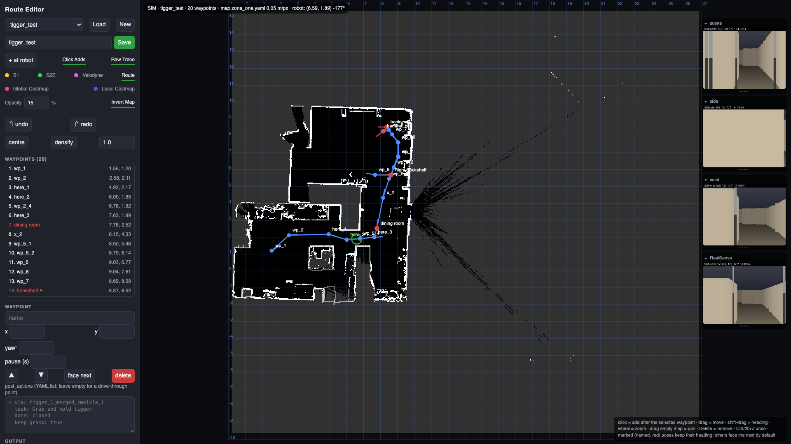
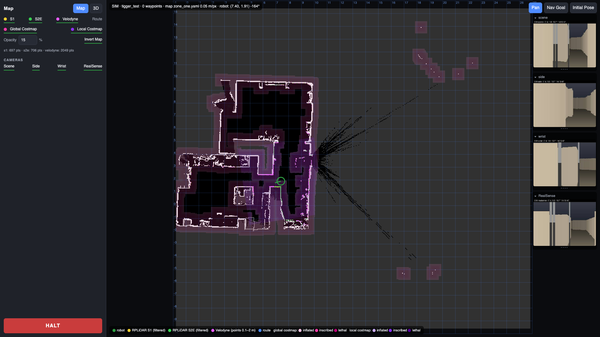
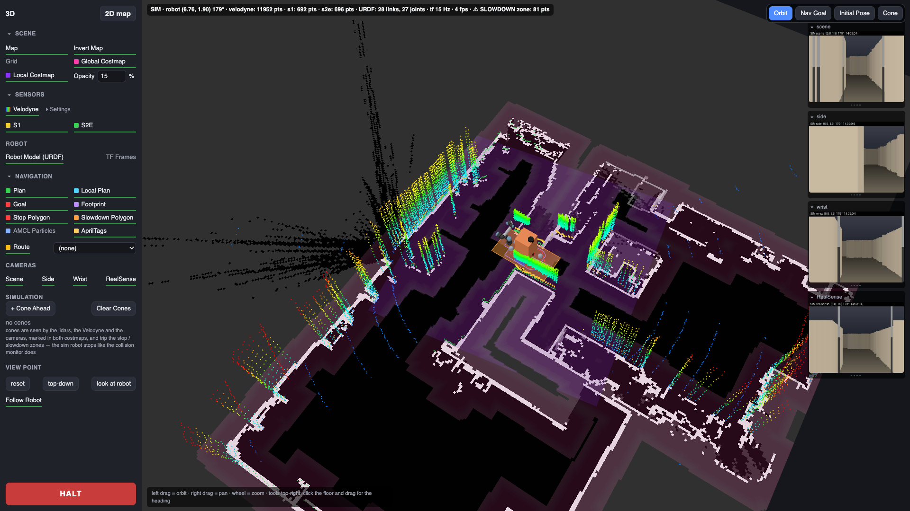

# Route editor, route recording and the waypoint runner

## Route editor, 2D map and 3D view in the browser (`Scripts/route_editor.py`)

One stdlib HTTP server on the robot (supervisor unit `robot_disco_route_editor`, autostarts, LAN only, no auth) serves the robot's console pages. The VLA manager embeds them as its Map, Routes and Landmarks tabs.

| URL | Page |
|---|---|
| `http://192.168.11.80:8092/` | **Route editor**: make and edit routes for `path.py` |
| `http://192.168.11.80:8092/?view=map` | **2D map**: the live map with the robot, the lidar scans, the Velodyne and both costmaps; nav goal / initial pose tools |
| `http://192.168.11.80:8092/3d` | **3D view**: the Foxglove-free 3D panel (map, costmaps, clouds, URDF, TF, Nav2 state, AprilTags, cameras) |
| `http://192.168.11.80:8093/cam/<scene\|side\|wrist\|realsense>.mjpg` (`.jpg` = one frame) | **Camera feeds** as MJPEG on a second port (`--cam-port`, default port+1), so four open streams do not starve the pages' own requests |
| `…:8092/api/…` | JSON: `map`, `routes`, `route`, `pose`, `costmap`, `scans`, `urdf`, `tf`, `cloud.bin`, `cameras`, `nav`, `obstacles`, `apriltags`, `landmarks` (+ `landmarks/img/*.jpg`); `POST` `halt`, `publish`, `route`, `tool`, `landmarks`, `landmarks/<id>/tasks`, `run`; `DELETE` landmarks |

**Route editor.** The nav2 map (the same `zone_one.yaml` AMCL uses) with a 1 m grid, the robot's live pose (green, from TF `map → base_footprint`), the routes in `Scripts/` (**Load** / **New** / **Save**) with their recorded trace (grey, **Raw Trace**) and the waypoint list. Click the map to add a waypoint after the selected one (**Click Adds**), drag to move it, shift-drag to turn its heading, Delete removes; the **Waypoint** panel has the name, `x` / `y` / `yaw°`, `pause (s)` (stop there that long before the actions run), ▲▼ to reorder, **face next** (heading toward the next waypoint), **delete** and the `post_actions` YAML; **+ at robot** adds a waypoint at the robot's pose named `here_N`. Undo / redo (Ctrl/⌘+Z, Shift for redo, Ctrl+Y; a drag is one step). Marked names (anything not matching `wp_…`, `x_…`, `start`, `here_…`) show red and keep their heading; `wp_…` points face the next one. **Save** writes `<name>.yaml` in `path.py`'s format and runs `path.py --check` on it; **centre** and **densify** (with its spacing field) run `record_path.py`'s tools on the saved file and reload it; the **Output** pane shows their result. Layer toggles (the label is the switch, underlined green when on): S1, S2E, Velodyne, Route, Global Costmap, Local Costmap, an opacity % (default 15) and **Invert Map**. **HALT** (both views) stops everything: cancel the Nav2 goal, zero velocity on `/cmd_vel_joy` and the wheel controller, SIGTERM `path.py` / `vla_action` / `pick_place_loop` / `eval_hw` and stop the `vla_eval` unit.


*The route editor with the `tigger_test` route (simulated robot and sensors, `route_editor.py --sim`).*

**2D map** (`?view=map`, the manager's Map tab in 2D). No editing: the map, the robot, the **filtered** RPLiDAR scans (S1 yellow, S2E green; what the costmaps see, transformed into the map frame by the editor's node and served at `/api/scans` about 5 Hz; `--raw-scans` / `--scan-topics` override), the Velodyne top-down (points 0.1–2 m), the global (pink) and local (purple) costmaps as overlays with a legend, and the camera strip on the right (a checkbox per feed, click to enlarge). Tools top-right: **Pan**, **Nav Goal** and **Initial Pose** (click, drag for the heading, release = publish `/goal_pose` or `/initialpose`; publishing needs the ROS node up, not a localized robot, so the initial-pose tool is for the unlocalized case). Hold a layer's colour swatch to recolour it (remembered per browser; the costmaps are rendered from one base colour each). In the simulator, cones can be dropped and dragged (`POST /api/obstacles`).


*The 2D map (simulated): both scans, the Velodyne, both costmaps, the camera strip.*

**3D view** (`/3d`, `map3d.html`; three.js + urdf-loader vendored under `Scripts/static/vendor`, no internet needed on RD). Accordions, remembered per browser: **Scene** (map, invert, grid, both costmaps, opacity; the local costmap is placed through `map → odom`), **Sensors** (Velodyne with its own settings fold: colour, size, rate, max; S1, S2E), **Robot** (URDF model with live joints, meshes from the package share dirs; TF frames), **Navigation** (plan, local plan, goal, footprint, stop / slowdown polygons that fill when tripped, AMCL particles, **AprilTags**: taught map poses in amber from the relocalizer's file and tags in view in green; the route selector), **Cameras**, **Simulation** (cones, sim only), **View point** (reset / top-down / look at robot, Follow Robot). A floating tool bar top-right: Orbit, Nav Goal, Initial Pose, Cone. The telemetry line across the top shows the robot pose, point counts, URDF links/joints, TF rate, and a ⚠ when a collision-monitor zone has points in it. HALT bottom-left.


*The 3D view (simulated): map, costmaps, Velodyne and lidar clouds, the URDF.*

**Landmarks and tasks** (`/api/landmarks*`, the manager's Landmarks tab). A landmark is a named place taken from where the robot stands: its map pose, the map's name, the side and scene cameras stitched into one photo and the RealSense frame, kept in `Scripts/landmarks/landmarks.yaml` (+ `img/`, git-ignored) next to the routes. Go queues the pose as a `/goal_pose`; rename, recapture the photos, update the pose, delete. A landmark's **tasks** tie a policy run to the place: what you say ("pick up tigger"), the model, the task string and the `vla_action.py` options (seconds, still, min_seconds, keep_grasp, home, done_when, still_mode, extra). The voice assistant reads the same file ("Robot Disco, pick up tigger" = drive there, then run it), and the tab's ▶ Run hands it the job over `/robot_voice/run_task` (503 when the voice assistant is not running). Task names are normalised (lower-case, no trailing punctuation) so the voice matcher sees what was typed.

**No robot at hand**: `python3 route_editor.py --sim` (`Scripts/sim_robot.py`) drives a simulated robot along a route (`--sim-route NAME`) and fabricates every input from the map alone: scans and a Velodyne cloud raycast against the walls, nav2-style costmaps (the local one in odom), TF, joints, plans / goal / polygons / particles, first-person camera renders, and the URDF (`sim/robot_sim.urdf` with primitives, or the real one after `sim/fetch_assets.sh` pulled it and the UR5e meshes from the robot); both pages show a SIM badge and the HALT latches until RESUME. `Scripts/dev_stack.sh start|stop|status|logs` brings up the whole GUI on a laptop: the sim editor on :8094 (cameras :8095), the VLA teleop panel with the MuJoCo arm on :8090 and the manager on :8081 with its Map tab on the sim (the manager's live / sim switch can also start the simulator by itself).

Flags: `--port` (8092), `--host`, `--cam-port`, `--map` (default `src/robot_disco/maps/zone_one.yaml`), `--no-ros` (no robot pose), `--sim`, `--sim-route`, `--raw-scans`, `--scan-topics name=topic,…`, `--apriltags-file` (default the relocalizer's `config/apriltag_landmark_poses.yaml`), `--landmarks-dir` (default `Scripts/landmarks`).

## Recording a route by driving (`Scripts/record_path.py`)

Instead of typing poses, drive the route once and let the recorder reduce it to waypoints:

```bash
sudo supervisorctl start robot_disco_localization     # AMCL on the saved map (TF map -> base_footprint)
cd ~/rd_ws/Scripts && python3 record_path.py record tigger
#   drive with the gamepad (hold the enable button); at each place that matters type its name + Enter
#   (bookshelf, banana_bed, …) — that pose is kept with the heading you parked at; q + Enter finishes
python3 path.py --check tigger.yaml
```

It samples the map pose whenever the robot moves (`--rate` 5 Hz, `--base-frame base_footprint`) and writes three files next to the script (`--out`): `tigger.raw.yaml` (every sample + marks), `tigger.yaml` (the route for `path.py`) and `tigger.svg` (grey raw trace, blue route, red marks — open it on the workstation). The reduction is Ramer-Douglas-Peucker with `--tolerance` metres of allowed deviation (default 0.25), cut at every mark, then unmarked points closer than `--min-spacing` (0.4 m) are dropped; unmarked waypoints face the next one so Nav2 does not spin to match a noisy heading. Marked names become the waypoint names, which is where `post_actions` go: `--actions-from tigger_route.yaml` copies the post_actions of same-named waypoints from an existing route, so a freshly recorded route gets its `vla:` actions in one step (or add them by hand afterwards). `--source amcl` samples `/amcl_pose` instead of TF. `--init-from ROUTE.yaml` or `--init X Y YAW_DEG` publishes an initial pose to seed AMCL before recording (it waits for AMCL's subscription first: discovery dropped quick publishes).

Subcommands:

| Command | Does |
|---|---|
| `record NAME` | drive and record (above) |
| `simplify NAME.raw.yaml [--tolerance 0.4] [-o out.yaml]` | re-reduce an existing raw trace without re-driving |
| `center ROUTE.yaml --map ../src/robot_disco/maps/zone_one.yaml [--max-shift 0.6] [--window 2.0] [--max-width 3.0] [-o out]` | move unmarked waypoints to the middle of their corridor on the nav2 map (free spans wider than `--max-width` are open areas and left alone); post_actions are kept |
| `densify ROUTE.yaml [--spacing 1.0] [-o out]` | insert intermediate waypoints on long legs |

The editor's **centre** and **densify** buttons run the last two on the saved file.

## Waypoint runner (`Scripts/path.py`)

A plain Python script (not a ROS package) built on `nav2_simple_commander`. Run it on the robot once bringup, localization and navigation are up:

```bash
cd ~/rd_ws/Scripts && python3 path.py                 # waypoints.yaml next to the script
cd ~/rd_ws/Scripts && python3 path.py tigger_route.yaml  # any route file
python3 path.py tigger_route.yaml --from wp_2             # start the route at that waypoint (skip the earlier ones)
python3 path.py --check tigger_route.yaml                 # parse only: segments + the commands, no ROS
python3 path.py tigger_route.yaml --no-deadman-stop       # the gamepad buttons do not stop the route
```

What it does, in order:

1. Waits for Nav2 to become active.
2. Loads `waypoints.yaml` from the same directory, or the route file given as the first argument.
3. If the file has an `initial_pose`, publishes it to `/initialpose` to seed AMCL, then runs its `post_actions`.
4. Publishes the route on `/waypoints_path` (`nav_msgs/Path`, transient-local) so the pages and Foxglove show it.
5. Waits for the `start_waypoints` Trigger service — the Foxglove "Party" button calls it — then runs Nav2 `FollowWaypoints`.
6. Runs each waypoint's background `post_actions` when the robot moves on to the next waypoint (arrival is inferred from the action feedback index advancing), and the last waypoint's on completion. A `pause: N` stops the robot there N s before its other actions run. A waypoint with a **blocking** action (`wait: true`, or any `vla:` action) ends a `FollowWaypoints` segment: the robot stops there, the blocking actions run in order while the node keeps spinning, then the next segment starts. A failed blocking action with `on_fail: stop` (the default) ends the route where the robot stands; Nav2 skipping a waypoint (`missed_waypoints`) also stops it.

Two guards run the whole time. **Deadman**: pressing the gamepad's drive-enable (RB) or turbo (LB) button (the indices in `src/robot_disco/config/joystick.yaml`) cancels the Nav2 goal and ends the route, SIGTERMing a running blocking action first (the eval's clean exit); `--no-deadman-stop` disables it. **Localization watchdog**: a map pose missing or stale for 3 s cancels the route, since Nav2 otherwise spins in recovery. The pages' **HALT** button SIGTERMs `path.py` too.

Route file format:

```yaml
waypoints:
  - name: charger
    position: {x: 2.99, y: 1.99, z: 0.0}
    orientation: {x: 0.0, y: 0.0, z: -0.004, w: 1.0}   # always give a full quaternion; a missing w defaults to 0
    pause: 5                                               # optional: stop here 5 s before the actions run
    post_actions:
      - 'ROS_DOMAIN_ID=0 ros2 topic pub /battery sensor_msgs/BatteryState "{percentage: 0.82, power_supply_status: 0}"'
      - ffplay -nodisp -autoexit /home/rd/Music/track.mp3   # plain strings: shell commands, run in the background
      - run: "some command"                                  # the same with options:
        wait: true                                           #   blocking — the robot stops here until it exits
        on_fail: stop                                        #   stop (default) | continue, blocking only
  - name: bookshelf
    position: {x: 2.54, y: 1.44, z: 0.0}
    orientation: {x: 0.0, y: 0.0, z: 0.995, w: 0.102}
    post_actions:
      - vla: pickup_tigger_smolvla_ft    # a VLA policy run on the arm (always blocking): a training run
        task: "pick up tigger"           #   name, run@step or a path under ~/rd_ws/VLA/outputs/train, and the
        seconds: 90                      #   task string it was trained with; cap on the playing phase (default 120)
        done: closed                     #   none (default) | closed | open — end by the grasp level: closed once the mean
                                         #   commanded curl has averaged >= 0.7 over `still` seconds (a pick), open once it
                                         #   averages <= 0.2 after having been closed (a place)
        still: 2                         #   averaging window (s) for done:, or without it: finish after N s without
                                         #   commanded motion (0 = off); still_mode: all | fingers picks what counts as motion
        min_seconds: 3                   #   never end before this
        keep_grasp: true                 #   carry the object: hand stays closed, UR stays powered for the drive
        home: true                       #   return the arm to its home (transport) pose at the end (default)
        wait_go: false                   #   launch paused and wait for PLAY (deck / page) as the go
        steps: 0                         #   cap in control steps (0 = off)
        on_fail: stop
        extra: ""                        #   extra vla_action.py arguments

initial_pose:
  position: {x: 0.36, y: -0.14, z: 0.0}
  orientation: {x: 0.0, y: 0.0, z: 0.012, w: 1.0}
  post_actions: []
```

A `vla:` action runs `VLA/run.sh scripts/vla_action.py` from the VLA checkout (`VLA_DIR` env overrides the default `rd_ws/VLA`), which stops the recording panel if it is up, switches the robot's inference server to that model (a ~30 s restart only when the model changes), runs `scripts/eval_hw.py --auto` and returns when the arm is back home; the run lands in the eval registry like any other. `Scripts/tigger_route.yaml` is the fetch-and-carry example (bookshelf → pick up Tigger → banana bed → place). The manager's Landmarks tab and the voice assistant run the same script for landmark tasks. Details: `VLA/wiki/Deploy-on-Hardware.md`, "Unattended runs".

All poses are in the `map` frame, so they must be re-recorded after a fresh SLAM map (see [Maps](Hardware-Bringup#maps)). The easiest way to capture a pose is **+ at robot** in the route editor, or drive there and `ros2 topic echo /amcl_pose --once`.
