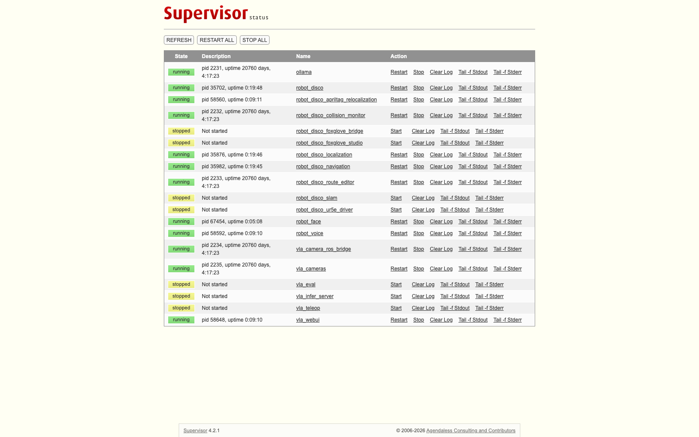

# Supervisor services

**Path**: `services/`
**Install script**: `Scripts/install_services.sh`

[Supervisord](http://supervisord.org/) manages all major robot subsystems as persistent background processes. Services auto-restart on failure where appropriate and write rotating logs to `~/rd_ws/log/`. The supervisor web UI is on `http://192.168.11.80:9999/` (no auth, LAN only), and the VLA manager's **Services** tab (`http://192.168.11.119:8081/#services`, or the robot's own manager on :8081) lists the same units with start / stop / restart, log tails and an **ordered base restart** (robot_disco → localization → navigation → collision monitor → route editor, each given time to settle, so every node rebinds to live publishers).



## Installation

```bash
sudo Scripts/install_services.sh      # runs from any directory
```

This copies every `services/*.conf` to `/etc/supervisor/conf.d/` and reloads the daemon, so a new `.conf` needs no changes to the script. Re-run it after editing any conf, then `sudo supervisorctl restart <service>`. The VLA units are installed separately, from the submodule: `cd ~/rd_ws/VLA && sudo ./scripts/install_services.sh rd` (which `provision/deploy_to_rd.sh --vla` runs).

## Service Overview

| Service | Command | Autostart | Autorestart |
|---|---|---|---|
| `robot_disco` | `ros2 launch robot_disco launch_robot.launch.py` | false | false |
| `robot_disco_localization` | `ros2 launch robot_disco localization_launch.py` | false | false |
| `robot_disco_slam` | `ros2 launch robot_disco online_async_launch.py` | false | false |
| `robot_disco_navigation` | `ros2 launch robot_disco navigation_launch.py` | false | false |
| `robot_disco_collision_monitor` | `ros2 launch nav2_collision_monitor collision_monitor_node.launch.py params_file:=…/collision_monitor_params.yaml` | **true** | **true** |
| `robot_disco_route_editor` | `python3 Scripts/route_editor.py --port 8092` (editor, 2D map, 3D view, landmarks, cameras :8093) | **true** | **true** |
| `robot_disco_apriltag_relocalization` | `ros2 launch robot_disco apriltag_relocalization_launch.py` | false | true |
| `robot_disco_ur5e_driver` | `ros2 launch robot_disco ur5e.launch.py` | false | true |
| `robot_disco_foxglove_bridge` | `ros2 launch robot_disco foxglove_bridge_launch.xml` | false | true |
| `robot_disco_foxglove_studio` | `docker run ... robotdisco/foxglove` (:8080) | false | true |
| `robot_face` | `ros2 launch robot_face combined_face_hand.launch.py` | false | false |
| `robot_voice` | `ros2 launch robot_voice voice_assistant.launch.py` (sources `~/.robot_face/voice.env` first) | false | true |
| `ollama` | `/usr/local/bin/ollama serve` (user `ollama`, loopback `:11434`, keep-alive 30 min; the voice assistant's on-robot fallback model) | **true** | **true** |
| `vla_cameras` | `VLA/run.sh scripts/camera_server.py` (owns the three USB cameras: multicast + MJPEG) | **true** | true |
| `vla_camera_ros_bridge` | `scripts/camera_ros_bridge.py` (the same frames as `/vla/cameras/<name>/image/compressed`) | **true** | true |
| `vla_infer_server` | `scripts/infer_server.py --ckpt outputs/serve_ckpt …` (SmolVLA on the Orin, :8777) | false | false |
| `vla_teleop` | `scripts/service_teleop.sh` (the recording panel, args in `VLA/config/teleop.env`, page on :8090) | false | false |
| `vla_eval` | `scripts/service_eval.sh` (the policy eval, args in `VLA/config/eval.env`, page on :8090) | false | false |
| `vla_webui` | `webui.server --port 8081` (the manager, the robot's copy) | true | true |

The `vla_*` units come from `VLA/services/rd/`. On boot the collision monitor, the route editor, Ollama, the camera service and its ROS bridge, and the robot's manager come up by themselves; everything else is started by hand once the robot is ready. The `robot_face` unit runs with the display environment it needs (`DISPLAY=:0`, the GDM `XAUTHORITY`, `XDG_RUNTIME_DIR`), so `sudo supervisorctl start robot_face` is the normal way to start the face.

## Service Details

**`robot_disco_foxglove_studio`** runs the Foxglove web UI inside Docker:
```
docker run --rm --name foxglove \
  --publish 8080:8080 \
  --volume /home/rd/rd_ws/foxglove_studio/foxglove-layout.json:/foxglove/default-layout.json:ro \
  robotdisco/foxglove
```
- `startsecs=10` — waits 10 s before marking healthy
- `stopsignal=INT` — graceful Docker shutdown
- `stoptimeout=10`
- logs in `/var/log/foxglove.*`, `HOME=/opt/foxglove`

**`robot_disco_slam`** runs slam_toolbox for building or updating a map. It publishes the `map → odom` transform, as does `robot_disco_localization`, so run one or the other, never both. After mapping, save with `map_saver_cli` and serialize the pose graph (see `maps/`).

**`robot_disco_collision_monitor`** sits in the drive path between `twist_mux` and the diff drive controller, so every velocity source (joystick, Nav2, behavior server) is gated by it. If it is not running the robot will not move.
```
joystick → /cmd_vel_joy ─┐
nav      → /cmd_vel_nav ─┼→ twist_mux → /cmd_vel_raw → collision_monitor → /diff_cont/cmd_vel_unstamped
behavior → /cmd_vel     ─┘
```
`twist_mux` priorities (`config/twist_mux.yaml`): joystick 100 > `cmd_vel_nav` 20 > `cmd_vel` 10, each with a 0.5 s timeout, so the joystick always overrides Nav2.

Launch args (the nav2 launch file's argument is `params_file`, plural; unknown args are silently ignored):
```
params_file:=/home/rd/rd_ws/src/robot_disco/config/collision_monitor_params.yaml use_sim_time:=false
```

**`robot_disco_route_editor`** runs from `Scripts/` with `ROS_LOG_DIR=~/.ros/log` (rclpy needs a writable log dir) and serves the editor, the 2D map, the 3D view and the landmarks API on :8092 and the camera MJPEG streams on :8093.

The ROS units share these settings:
- `ROS_DOMAIN_ID=0`
- `FASTRTPS_DEFAULT_PROFILES_FILE=/home/rd/rd_ws/services/fastdds_no_shm.xml`: a UDP-only Fast DDS profile (no shared-memory transport). Stale SHM segments after restarts silently cut data between processes (Nav2 lost the map frame, AMCL ignored `/initialpose`); the profile is also exported in `~/.bashrc` so a shell's `ros2` sees the same traffic
- Working directory `/home/rd/rd_ws`, user `rd` (Ollama runs as `ollama`, Foxglove Studio from `foxglove_studio/`)
- `stopasgroup=true`, `killasgroup=true` — ensures all child processes are cleaned up
- Log rotation: 20 MB max, 2 backups per service (5 MB for the route editor)

## Supervisorctl Commands

`supervisorctl` needs `sudo` on the robot.

```bash
# View all service states
sudo supervisorctl status

# Typical navigation session
sudo supervisorctl start robot_disco                 # bringup: drivers, camera, TF, twist_mux
sudo supervisorctl start robot_disco_localization    # AMCL on the saved map (not with robot_disco_slam)
sudo supervisorctl start robot_disco_navigation
sudo supervisorctl start robot_disco_apriltag_relocalization   # optional

# Mapping session instead of localization
sudo supervisorctl start robot_disco_slam

# Others
sudo supervisorctl start robot_face robot_voice
sudo supervisorctl start robot_disco_ur5e_driver      # only for ROS-side arm work; VLA runs drive the arm over RTDE instead
sudo supervisorctl start vla_infer_server             # before a policy run (VLA unit)

# Stop / restart
sudo supervisorctl stop robot_disco_navigation
sudo supervisorctl restart robot_disco_ur5e_driver

# Stream logs
sudo supervisorctl tail -f robot_disco
sudo supervisorctl tail -f robot_disco_route_editor
```
